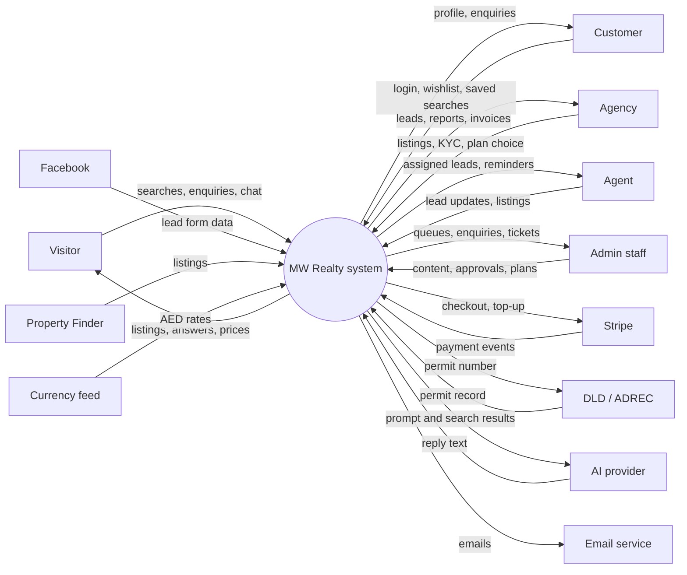
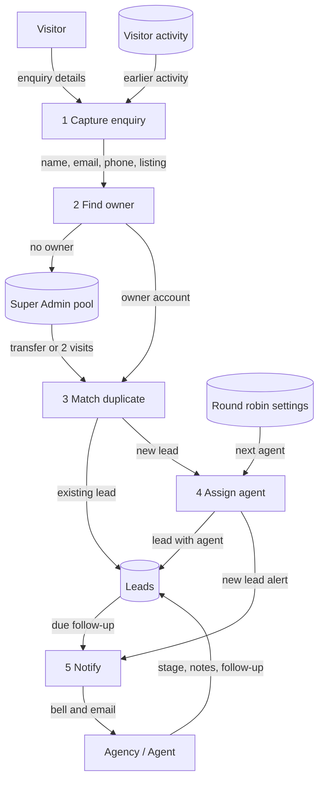
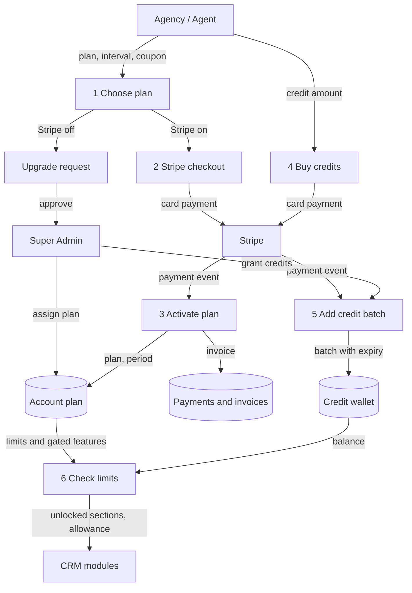
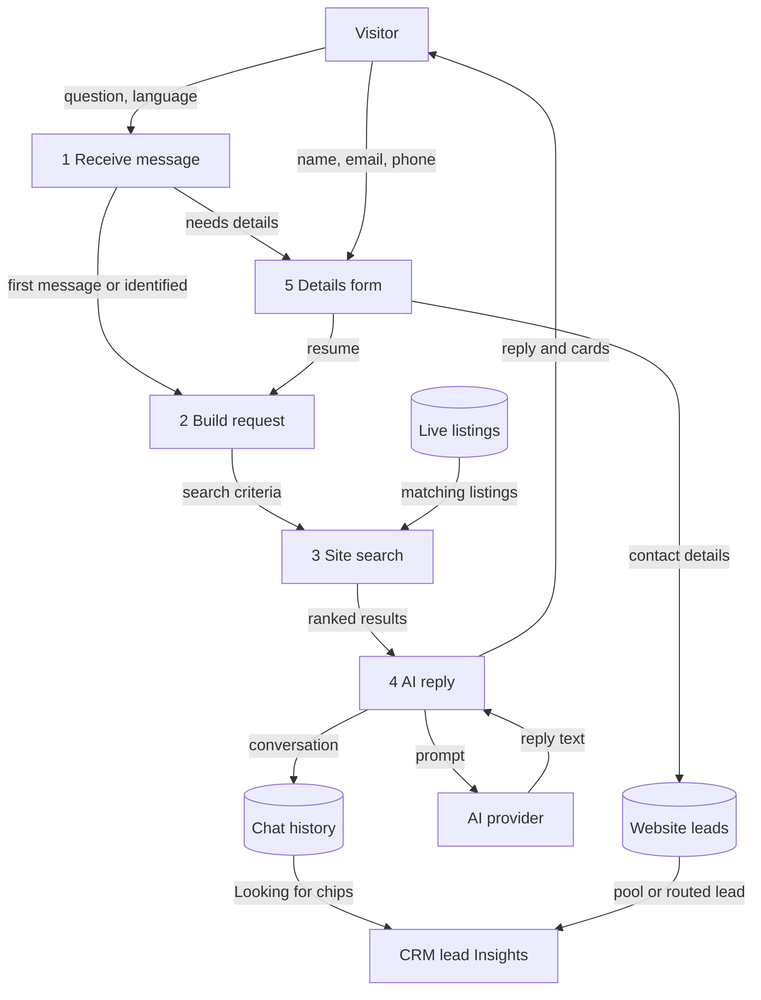

# Business & Functional Requirements (BRD / FRD)

What MW Realty must do for the business, what each part of the system does, how data moves through it, and what the key screens look like.

**Scope:** The whole MW Realty platform as built on the crm-api branch (November 2026): the public website (/), the Admin / CMS (/admin), the partner CRM (/crm) for agencies and agents, the customer and mobile app APIs (/api), and the outside services they use. Requirements are written from the code and the tester handbook (Overview 00 and Modules 01 to 26). Anything the code does not settle is marked "To be confirmed with the client".

## 1. Purpose and business objectives

### 1.1 Purpose of this document

This document gives the testing team one reference for what the system is meant to do. It sets out the business requirements (BR), the functional requirements (FR) that deliver them, data flow diagrams (DFD), low-fidelity wireframes of the main screens, and a traceability table that links each requirement area to its module test guide.

The module test guides are more detailed than this document. When this document and a module guide differ, follow the module guide and report the difference to the project team.

### 1.2 What MW Realty is

MW Realty is a real-estate marketplace for the UAE with a built-in CRM for agencies and agents. Buyers and tenants search residential and commercial listings on the public website and contact the agency or agent behind each listing. Agencies and agents publish listings and work their enquiries (leads) in the CRM. The MW Realty team runs the platform from the Admin: it approves partners, sets up plans and manages website content.

> In one sentence: what a visitor does on the website becomes a tracked lead, and the system sends that lead to the right agency or agent to follow up.

### 1.3 Business objectives

| No. | Objective | How the system measures it (where the code shows it) |
| --- | --- | --- |
| OBJ-1 | Turn website traffic into leads for partners | Leads created per source and per period (Reports > Leads, Module 17); conversion and win rate (Dashboard gauge, Module 01); Lead Insights engagement (Module 03) |
| OBJ-2 | Route every enquiry to the right person with no duplicates | Routing rules (owner, assigned agent, round robin, Super Admin pool); duplicate leads merged by email or phone; repeat enquiry count on the lead (Module 02, 04) |
| OBJ-3 | Keep only lawful, accurate listings on the website | Permit status per listing (Module 07, 09); Listing Review tiles: Duplicate rate, Flagged in last 30 days, Permit verification %, Avg. time to resolve (Module 24) |
| OBJ-4 | Earn recurring revenue from partners | Plan subscriptions and invoices (Module 23); credit top-ups (Module 20); website ad bookings (Module 11); "MW Realty Plan Sales" in Reports for the Super Admin (Module 17) |
| OBJ-5 | Reduce manual work for MW Realty and partners | Listing Review "Time saved, last 30 days" (Module 24); import "% of rows imported with nothing left to fill in" (Module 25); Facebook and Property Finder automation (Module 06) |
| OBJ-6 | Give partners proof of value | Listing performance, ad impressions, clicks and CTR (Modules 07, 11); Reports (Module 17); Dashboard KPIs (Module 01) |
| OBJ-7 | Help buyers decide, in their own language and currency | Compare page, Market Insights, calculators, AI chat in 10 languages, currency switcher (Module 26, Overview section 2) |
| OBJ-8 | Onboard only verified partners | KYC submission and approval before most CRM modules unlock (Module 21); 2FA (Module 22) |

> Numeric business targets (for example a target number of leads or partners per month) are not in the code. To be confirmed with the client.

## 2. Stakeholders and user types

### 2.1 User types

| User type | Where they sign in | Goals in the system |
| --- | --- | --- |
| Visitor | No sign-in | Search and compare listings, read content, use calculators and the AI chat, send enquiries and viewing requests. Activity is tracked by an anonymous browser cookie until they give contact details. |
| Customer (shown as "User") | /login > User tab, or "Continue with Google" | Keep a wishlist, saved searches, My Enquiries and account settings at /profile. Cannot open the CRM. |
| Agency (company account) | /login > Agent / Agency tab | Publish listings, work leads, manage a team of agents, buy a plan and credits, advertise, connect Facebook and Property Finder, see reports. Can make 2FA compulsory for its agents. |
| Independent agent | /login > Agent / Agency tab | Same as an agency for their own work (own plan, credits and ads), with no team. |
| Agency agent | /login > Agent / Agency tab | Work the leads and listings assigned to them using the agency's plan and credits. Manage invitations and join requests under My Agency. |
| CMS staff | /admin | Run the parts of the Admin their role and permissions allow (for example blogs.edit). |
| Super Admin | /admin, then the CRM button in the top bar | Full Admin access. In the CRM, a global view of every account plus Super Admin-only modules: Website Leads, Listing Permits, Listing Review, Marketing Properties, Property Options, ad review and Property Finder import review. |
| Mobile app user | Mobile app, through /api/auth (token) | Customer functions through the API (register, verify code, log in, Google, wishlist, saved searches, settings). The mobile app itself is outside this code base. |

Old links /agent-login, /agency-login and /portal/login lead to /login; /agent-signup and /agency-signup lead to /signup.

### 2.2 Other stakeholders

| Stakeholder | Interest |
| --- | --- |
| MW Realty management (client) | Revenue, partner growth, compliance, brand |
| MW Realty support team | Answers support tickets (Admin > Support Tickets), keeps Help Desk guides current |
| UAE authorities (DLD / RERA, DTCM, ADREC) | Advertising permits on listings. MW Realty records and checks permits; it never issues them. |
| Outside service providers | Stripe, Meta (Facebook), Property Finder, Google, the AI provider, the email service, Cloudinary, the currency rate feed |
| QA / testing team | Verifies the requirements in this document against the module guides |

## 3. Scope

### 3.1 In scope

| Area | In scope |
| --- | --- |
| Public website | Home, property search (list and map), commercial, Premium and marketing pages, property details (with insights tabs), compare, agents and agencies, blogs, market insights, careers, landing pages, calculators, contact, legal pages, sign up and log in, customer profile, AI chat, language (English and Arabic, right-to-left) and currency switching, visitor tracking, ad slider |
| Admin / CMS | Clients (KYC, memberships, plan requests), plans, payments, coupons, credits and credit history, support tickets, Help Desk content, website content, filters and locations, enquiries, newsletter, unassigned leads, languages and translations, currencies, site information, SEO, sitemap, robots.txt, redirects, 404 logs, staff roles and permissions |
| Partner CRM | Modules 01 to 27 of the tester handbook (Dashboard, Leads, Follow-ups, Lead Insights, Website Leads, Master, Integrations, Properties, Commercial, Import and Write with AI, Listing Permits, Listing Review, Premium, Advertisements, Sold Listings, Marketing Properties, Agents and My Agency, Agent Insights, Property Insights, Nearby Places, Listing Settings, Reports, Help Desk, Contact Us, Credits, My Profile, Security, Plans) |
| Mobile and public APIs | /api endpoints used by the website and the mobile app: content, search, property details, compare, lead capture, AI chat, tracking, customer token auth and customer account. /api/crm serves the CRM screens. |
| Integrations | Stripe (plans, credits, webhooks), Facebook Lead Ads (login, Pages, webhook, sync), Property Finder (listing import), DLD / ADREC permit check (when connected), Google sign-in (customers), AI provider (chat, compare summary, Write with AI, import descriptions), email, Cloudinary media, currency rate feed |
| Background jobs | Email and notification queue, permit expiry, Premium start / end, ad settlement, credit expiry, renewal reminders, document expiry, Facebook Page check, tracking clean-up, imports, photo screening |

### 3.2 Out of scope

| Area | Out of scope |
| --- | --- |
| Mobile app | The app's own screens and store builds (only its APIs are in this code base). Mobile app test coverage: to be confirmed with the client. |
| Permits | Issuing permits. MW Realty only records, validates and approves them. |
| Payments | Card handling (Stripe holds card data); refunds on downgrade (none by design). Refund process outside Stripe: to be confirmed with the client. |
| Third-party systems | Testing the inside of Meta, Property Finder, DLD / ADREC, Stripe or the AI provider |
| Transactions | Conveyancing, mortgages and legal advice. The AI and calculators give general information and estimates only. |
| Admin screens in detail | Admin is described at overview level. Detailed Admin test guides beyond what CRM modules depend on: to be confirmed with the client. |

## 4. Business requirements

| ID | Requirement | Area | Priority |
| --- | --- | --- | --- |
| BR-01 | Visitors can search, filter, view and compare live residential and commercial listings across the UAE, on desktop and mobile, in English or Arabic. | Website | High |
| BR-02 | Every website enquiry (listing enquiry, viewing request, brochure or floor-plan download, profile request, custom request, contact form, AI chat details) is captured as a lead and never lost. | Website, CRM | High |
| BR-03 | Each lead is routed to the right account and agent automatically (owner, assigned agent, round robin) or held in a Super Admin pool when it has no owner. | CRM | High |
| BR-04 | One person is one lead per account: repeat enquiries are merged by email or phone, not duplicated. | CRM | High |
| BR-05 | Partners can work leads through a pipeline: stage, tags, source, notes, follow-ups with reminders, assignment, import and export. | CRM | High |
| BR-06 | Only approved (KYC) partners can publish listings and work leads. Partners submit identity and licence documents, and MW Realty approves or rejects them. | CRM, Admin | High |
| BR-07 | A listing may appear on the website only while it is switched on, has a valid advertising permit for its emirate (or needs none), is not sold, and is not held by Listing Review. | CRM, Website | High |
| BR-08 | The system screens every listing save for the same unit listed by another agency and for risk signals, and lets the Super Admin approve or reject. | CRM | High |
| BR-09 | Partners pay for plans (monthly or yearly) that set listing allowance, Premium quota, ads, team size, reports and gated features. | CRM, Admin, Stripe | High |
| BR-10 | Partners can buy prepaid credits with an expiry date to go past plan limits (extra listing, Premium, ads). | CRM, Admin, Stripe | High |
| BR-11 | Partners can promote listings as Premium and book banner ads on website pages, with MW Realty approval of ads and impression / click reporting. | CRM, Website | Medium |
| BR-12 | Agencies can build a team (add, invite, accept join requests), with MW Realty approving every membership. | CRM, Admin | Medium |
| BR-13 | Partners can bring in leads from Facebook Lead Ads and listings from Property Finder or an Excel / CSV file. | CRM, Integrations | Medium |
| BR-14 | Partners see performance: dashboard, reports, lead insights, listing performance and ad reports; agencies also see how each agent handles the leads and listings assigned to them (agent insights). | CRM | Medium |
| BR-15 | MW Realty staff manage all website content, filters, locations, translations, currencies and SEO without code changes. | Admin | High |
| BR-16 | Staff access is controlled by roles and permissions; data of one partner is never visible to another. | Admin, CRM | High |
| BR-17 | Partner accounts are protected by optional or agency-enforced 2FA and a new-device email check. | CRM | High |
| BR-18 | Customers can keep a wishlist, saved searches and view their enquiries; customers may sign in with Google. | Website, API | Medium |
| BR-19 | An AI assistant answers visitors in 10 languages using only real search results, and captures contact details to keep chatting. | Website, AI | Medium |
| BR-20 | The mobile app can use the same backend through token-authenticated APIs. | API | Medium |
| BR-21 | Partners and MW Realty receive bell notifications and emails for the events that need action. | All | Medium |
| BR-22 | Partners can raise support tickets and read quick guides for each CRM screen. | CRM, Admin | Low |
| BR-23 | Forms and AI are protected against abuse with rate limits per network address. | Website, API | Medium |
| BR-24 | Prices are stored in AED and shown in the visitor's chosen currency; times for bookings are in Dubai time. | Website, CRM | Medium |

## 5. Functional requirements

Module numbers refer to the tester handbook: "Overview" is document 00, "Module 07" is document 07, and so on.

### 5.1 Public website

| ID | Requirement | Module guide reference |
| --- | --- | --- |
| FR-101 | Home page shows the banner search, New Projects by city, Premium Properties (up to 12), Luxury Projects, "Realty Property" (first 12 Marketing Properties), communities, popular places, testimonials and the ad slider. | Overview s.2; Modules 10, 13 |
| FR-102 | /properties and /properties/map filter by Purpose, Location / Title (with suggestions), Property Type, Price Range, Bedrooms, Bathrooms, Area, features and amenities; list or map view. | Overview s.2 |
| FR-103 | /commercial, /premium-properties and /marketing-properties (each with a map view) show only their own listings; marketing keeps the Super Admin's order. | Modules 08, 10, 13 |
| FR-104 | Only live listings are listed or opened: Active, permit Verified (or none needed), not expired, not sold, not held or rejected by Listing Review. | Modules 07, 09, 24 |
| FR-105 | /property-details/{slug} shows Overview, Features & Amenities, Gallery, Floor Plans, permit details, nearby places on a map, Similar Properties (up to 6), Send Enquiry, Request Viewing, brochure / floor-plan download (contact details first), call and WhatsApp buttons. | Overview s.2; Modules 07, 15, 26 |
| FR-106 | Property details shows Mortgage & Investment (sale), Rental Costs (rent) and Market Insights (assessment badge, area price per sq.ft, 8-quarter trend, recent deals) with a source tag per figure. | Module 26 |
| FR-107 | Compare: tick up to 5 listings (minimum 2); compare bar on every page; /compare?slugs=... shows price, costs per emirate, yields, specs, nearest places, amenities, ownership and Golden Visa; "Only show differences"; currency picker; AI summary or Quick summary. | Module 26 |
| FR-108 | Agents and agencies pages list approved partners with their listings and a property request form that creates a lead for that partner. | Overview s.2 |
| FR-109 | Blogs, market insights, careers (with application form), about, legal pages and landing pages come from Admin; a landing-page form is captured as an enquiry. | Overview s.2 |
| FR-110 | Calculators (mortgage, eligibility, rent vs buy, refinance) compute in the browser; copy, FAQs and form text come from Admin. Results must match Property Finder's formulas for the same inputs. | Overview s.2 |
| FR-111 | Contact form saves to Admin > Enquiries, creates a website lead and emails the admin. | Overview s.2; Module 04 |
| FR-112 | Sign up has three account types (User, Agent, Agency); log in has two tabs (User, Agent / Agency); every sign-up confirms the email with a code valid 10 minutes; Google sign-in is for customers only. | Overview s.1, s.3; Module 22 |
| FR-113 | Customer profile (/profile): Overview, Wishlist, Saved Searches, My Enquiries, Account Settings; a guest who clicks a heart is sent to /login. | Overview s.2 |
| FR-114 | Language dropdown lists languages enabled in Admin; Arabic switches to right-to-left. Currency switcher converts AED prices with Admin-set (or synced) rates and remembers the choice. | Overview s.2; Module 26 |
| FR-115 | Every browser gets an anonymous visitor cookie; page views, listing views, time on page, searches, favourites, saved searches, chats and contact clicks are recorded and attached to the person once identified. | Modules 03, 04 |
| FR-116 | Custom Property Request on /properties creates a lead with no owner for the Super Admin. | Overview s.2; Module 04 |
| FR-117 | Rate limits per IP: about 20 lead / enquiry submissions per hour, 10 sign-ups per hour, 5 login attempts per minute per email; compare 60 per minute; compare summary 10 per minute and 100 per day. | Overview s.2; Module 26 |

### 5.2 AI chat

| ID | Requirement | Module guide reference |
| --- | --- | --- |
| FR-151 | The chat widget is on every page; the assistant name comes from a setting (default "Noor"). | Module 26 |
| FR-152 | The visitor may ask one question freely; to continue, they fill "Want to keep chatting?" (name, email, phone) or close it with "Not now". Giving details creates a website lead. | Overview s.2; Modules 04, 26 |
| FR-153 | The AI answers only with listings that a real site search returns: up to 6 residential cards with "N% match" (and up to 3 reasons in English). | Module 26 |
| FR-154 | Chat in 10 languages with a language button, an offer to switch when the visitor types in another language, right-to-left for Arabic, Urdu and Persian, and voice input / read-aloud where the browser supports it. | Module 26 |
| FR-155 | Conversations are saved and shown on the lead's Insights tab with "Looking for" chips. | Modules 03, 26 |
| FR-156 | Limits: 8 messages per minute and 150 per day per IP. Without an AI provider the widget shows a fixed "not available" line. | Overview s.2; Module 26 |

### 5.3 Admin / CMS

| ID | Requirement | Module guide reference |
| --- | --- | --- |
| FR-201 | Menus and actions require permissions given through roles (User Management > Admins, Roles, Permissions). Only the Super Admin sees the CRM button. | Overview s.5 |
| FR-202 | Clients: review KYC (approve, reject with reason, request information on sections, verify or reject single documents), enable / disable, reset password or 2FA, assign a plan, payment status; badges count waiting items. Approval only after the partner has submitted. | Overview s.3, s.5; Module 21 |
| FR-203 | Agency agents: approve, reject, suspend, reactivate or remove memberships. | Module 14 |
| FR-204 | Plans: price, monthly or yearly, listing limit, Premium quota, ads, agent limit, reports and gated features. Plan upgrade requests are approved or rejected here when Stripe is not used. | Module 23 |
| FR-205 | Payments with invoices; coupons (percentage or fixed AED; once, N months or forever; never on free plans). | Module 23 |
| FR-206 | Credits: switch on or off, set price per credit, VAT, validity and cost table; grant credits to an account; view and export the ledger. | Module 20 |
| FR-207 | Support Tickets: reply to CRM tickets; Help Desk: edit the quick guide for each CRM screen. | Modules 18, 19 |
| FR-208 | Website content: home sections, banners, about, why choose us, builders, testimonials, FAQs, blogs, market insights, landing pages and their enquiries, careers and candidates, calculators, contact page, legal pages. | Overview s.5 |
| FR-209 | Filters and locations for each listing page; communities; Find Properties. | Overview s.5 |
| FR-210 | Enquiries, newsletter sign-ups and unassigned property leads (to hand to a partner). | Overview s.5; Module 04 |
| FR-211 | Languages and translations, currencies (rates, default), site information, SEO metadata, sitemap, robots.txt, URL redirects and 404 logs. | Overview s.5; Module 26 |

### 5.4 Partner CRM (Modules 01 to 26)

General rules for every CRM module:

- Data scope: an agency sees its own and its team's data; an agent sees their own and what is assigned to them; the Super Admin sees everything. Another account's record must never open, even by typing its ID in the URL.
- KYC lock: until approval, locked items show a padlock "Unlocks after KYC approval" and the server refuses the URL with "Your account is pending Super Admin approval."
- Plan lock: gated items show "Upgrade your plan to unlock this" (or the module's own wording) and an "Unlock ..." card.
- Disabling an account or changing its password signs out its other sessions on their next click.

| ID | Requirement | Module guide reference |
| --- | --- | --- |
| FR-301 | Dashboard: read-only hero (greeting, 30-day summary, alert chips, plan or top-partners card), 6 KPI cards (Total enquiries, Deals in progress, Deals won, Need follow-up, Listings, Premium), Performance (12 weeks), Conversion gauge, Buyer Insights, Deal Pipeline, Latest Enquiries, Most Desired / Latest Properties, Inventory. Never locked. | Module 01 |
| FR-302 | Leads list: filters, quick-filter chips with counts, sortable table with selectable columns, select page or all, bulk Assign Stage, Assign Tag, Export, Delete; Lead Assignment and Distribute unassigned (agency); Add Lead. | Module 02 |
| FR-303 | Lead page: header with status, ID, date, channel, chips, Call / WhatsApp / Email; tabs Profile, Timeline, Summary, Insights; previous / next lead. | Module 02 |
| FR-304 | Lead routing: listing's agent, independent agent, agency round robin (per lead kind: property, generic, Facebook) skipping suspended or departed agents, agency unassigned in manual mode, Super Admin pool for no owner. | Overview s.6B; Modules 02, 14 |
| FR-305 | Duplicate handling: inside one account a repeat enquiry with the same email or phone is merged ("repeat enquiry" entry, count up); a person already a lead of one account stays with that account. | Overview s.2; Module 02 |
| FR-306 | Follow-ups: schedule a Call / WhatsApp / Email or log one done; reminder bell and email 15 minutes before due; complete, reschedule, cancel; Follow-ups page with Overdue / Today / Upcoming / Done; sidebar badge = overdue count. | Module 02 |
| FR-307 | Lead import (Excel template, Leads export or Meta CSV) runs in the background with progress and a status file; Deleted Leads can be restored or deleted permanently. | Module 02 |
| FR-308 | Lead Insights lists leads linked to a tracked visitor with property views, time on site, searches, AI chats and last active; plan-gated. | Module 03 |
| FR-309 | Website Leads (Super Admin): tabs Lead Pool, Routed Leads, All; manual Transfer; automatic routing after 2 visits to one account's listings (views within 30 minutes count once); badge = pool leads from the last 7 days. | Module 04 |
| FR-310 | Master: Stage (colour, Closed?, one Default, drag order), Tag, Source; shared "MW Realty" items from the Super Admin plus each account's own items; Property Options (Super Admin) for listing-form and search dropdowns. | Module 05 |
| FR-311 | Integrations hub with a tile and status per integration (Facebook Lead Ads, Property Finder, Excel / CSV import). | Modules 06, 25 |
| FR-312 | Properties: list (search, filters, Permit pills, plan chips, grid / list, bulk actions, drag order, 16 per page), detail page, and a 12-tab form (Core details, Property Details, Agent & Agency, Location, Amenities, Easy Access, Attributes, Floor Plans, Images, Brochure, Nearby Places, Publishing). | Module 07 |
| FR-313 | Permit status is recalculated on every save: Permit details needed, Not verified, Verified, Taken down, Permit expired. Validate checks RERA / ADREC online when connected. Editing permit, price, purpose, type, bedrooms or size sends a verified listing back for checking. One permit number per listing. | Modules 07, 09 |
| FR-314 | Plan allowance: Free plan caps listings held at once; paid plans allow N new listings per calendar month; deleting does not return a slot; extra listings can be paid with credits. | Modules 07, 20, 23 |
| FR-315 | Mark as sold / rented: outcome, price, date, buyer (existing lead or new), proof documents; listing goes off the website, lead moves to the won stage, Premium removed. | Modules 07, 12 |
| FR-316 | Commercial uses the same screens and rules as Properties; the menu used to add the listing decides the list and website page; the plan allowance is shared. | Module 08 |
| FR-317 | Listing Permits (Super Admin): five status tabs, review page with permit card, "Does the ad match the permit?", history, checklist, Approve & publish, Take down (with reason). | Module 09 |
| FR-318 | Premium: book one or several listings for 7 / 15 / 30 / 60 / 90 days within the limit, paid from plan quota or credits; Scheduled or Live; job every 15 minutes starts and ends bookings; Edit, Stop, Cancel. | Module 10 |
| FR-319 | Advertisements: 4-step booking (banner, link, page and time, payment), whole hours from the hour in Dubai time, Super Admin approve / reject / take down, MW Realty's own ads, placements and pricing per page, impressions / clicks report; unreviewed or rejected bookings are refunded. | Module 11 |
| FR-320 | Sold Listings register with tiles (Sold, Sales Value, Rented, Rental Value), filters and Revert. | Module 12 |
| FR-321 | Marketing Properties (Super Admin): pick accounts, add their active listings to the top, drag order, remove; rows 1 to 12 show on the home page. | Module 13 |
| FR-322 | Agents (agency): agent slots, round-robin settings, add new agent, invite existing agent, accept join requests, suspend, reactivate, remove; every membership needs Super Admin approval. My Agency (agent): invitations, request to join, leave. | Module 14 |
| FR-323 | Nearby Places: shared list of typed landmarks with names per language and coordinates; only the creator (or Super Admin) can edit; only Active places show. | Module 15 |
| FR-324 | Listing Settings: logo or text watermark (position, opacity, size) burned into new photo uploads; Super Admin default watermark; plan-gated. | Module 16 |
| FR-325 | Reports: Leads, Properties, Sales (with CSV export) and Agents tabs; 7 / 30 / 90 days / 12 months; plan-gated. | Module 17 |
| FR-326 | Help Desk: quick guide for each screen (also the "!" icon in the top bar). | Module 18 |
| FR-327 | Contact Us: raise tickets (issue type, priority, subject, message, attachment), conversation thread, statuses, mark solved, reopen; badge for tickets awaiting reply. | Module 19 |
| FR-328 | Credits: balance, expiry, period totals, history with export, calculator, Buy credits by card; batches expiring first are spent first; cancelled bookings refund credits. | Module 20 |
| FR-329 | My Profile: account details, public page details, KYC documents (JPG, PNG or PDF up to 4 MB), completeness %, Submit / Resubmit for Approval, login email change, document expiry emails. | Module 21 |
| FR-330 | Security: 2FA with an authenticator app, 8 recovery codes, new-device email code, recognised devices, agency-enforced 2FA for agents. | Module 22 |
| FR-331 | Plans: current plan and usage, monthly / yearly, coupon, Stripe checkout, upgrade (prorated), scheduled downgrade, stop auto-renew, payment history and PDF invoices; request flow when Stripe is off. | Module 23 |
| FR-332 | Listing Review (Super Admin): every listing save is screened; same unit from another agency (unit number or matching photos) holds newer copies off the website; risk signals (price far off, details don't add up, advertiser authority, ad differs from permit record, resubmitted after rejection); Approve or Reject with reason; measure tiles. | Module 24 |
| FR-333 | Property import: upload Excel / CSV, match columns, import in the background (one per account), row results Added / Needs details / Duplicate / Skipped, status file kept 30 days; listings created Inactive; plan limit checked per row; credits never used. | Module 25 |
| FR-334 | Write with AI in the listing form drafts or improves title, key features and description in the selected language from the form's details; nothing is saved until Save / Update; 20 requests per minute per user. | Module 25 |
| FR-335 | Super Admin opens the CRM in a global view and returns with Back to Admin; the sidebar shows Super Admin-only modules. | Overview s.4; Module 01 |
| FR-336 | Agent Insights (agency, Super Admin): per agent leads received, response rate within 24 hours, median response time, untouched leads, overdue follow-ups, live listings, average listing quality, closed leads and deals, and an Agent score out of 100 with a breakdown; agent page lists the untouched leads, overdue follow-ups and listings needing work; period 7 / 30 / 90 days; plan-gated (`agent_insights`). | Module 26 |
| FR-337 | Property Insights (all accounts, Super Admin): every listing on the market the account can see with impressions, listing clicks, lead clicks and leads for 7 / 30 / 90 days, quality score, totals, a day-by-day chart, No impressions count, search, Residential / Commercial filter and sorts; a row opens Listing Performance; plan-gated (`property_insights`). The CRM sidebar groups Property Insights, Agent Insights, Lead Insights and Reports under Insights. | Module 27 |

### 5.5 Integrations

| ID | Requirement | Module guide reference |
| --- | --- | --- |
| FR-401 | Facebook Lead Ads: connect with Facebook Login, link each Page to one account; new form leads arrive by webhook as CRM leads with the ad set / ad name as Source; Sync now and All leads; daily check flags broken Pages and emails a reconnect request; data-deletion callback. Plan-gated. | Module 06 |
| FR-402 | Property Finder: connect with API key and secret; Import all listings first, then Sync new listings; imported listings are created off the website and wait for Super Admin review; approve enters the permit flow, reject deletes and never re-imports; plan limit stops the import; agency agents can view and sync only. Plan-gated. | Modules 06, 25 |
| FR-403 | DLD / ADREC: Validate checks RERA and ADREC permits online when the authority API is enabled; otherwise listings wait for Super Admin approval. DTCM and "None" always need approval. | Modules 07, 09 |
| FR-404 | Stripe: plan checkout and subscription changes, credit top-ups, background confirmation through the Stripe webhook; test mode only on QA. | Modules 20, 23 |
| FR-405 | Google sign-in ("Continue with Google") for customer accounts only, on the website and through the API. | Overview s.1 |
| FR-406 | AI provider (configurable, Groq or Gemini): AI chat, compare summary, Write with AI and import descriptions; each feature has a fixed fallback or a clear error when AI is not set up. | Modules 25, 26 |
| FR-407 | Currency rate feed: optional hourly sync of active currencies (setting CURRENCY_RATES_AUTO_SYNC, default off); a currency missing from the feed keeps its rate. | Module 26 |
| FR-408 | Media (photos, documents) stored in Cloudinary; photos converted and watermarked on upload or import. | Modules 16, 25 |
| FR-409 | Auto-translate of listing text into other site languages when it is set up. | Module 25 |

### 5.6 Notifications and background jobs

| ID | Requirement | Module guide reference |
| --- | --- | --- |
| FR-501 | Emails are queued and sent within 1 to 2 minutes; sign-up and login codes are sent immediately. | Overview s.6 |
| FR-502 | Partner receives: sign-up and new-device codes; KYC approved, rejected, info requested, document flagged; membership changes; new lead (owner and assigned agent); follow-up reminder; lead import finished; listing sent for approval, approved, taken down, permit expiring or expired; ad reviewed; Facebook leads synced or reconnect needed; Property Finder results; ticket replies; plan invoice, renewal reminder; document expired. | Overview s.6 |
| FR-503 | Super Admin / site address receives: new KYC submission, plan upgrade request, listing waiting for approval, lead with no owner, contact / landing-page / career / newsletter submissions, new ticket messages. | Overview s.6 |
| FR-504 | Listing Review and listing import send bell notifications only (no email): listing waiting for review, rejected, approved; import finished or failed. | Modules 24, 25 |
| FR-505 | Scheduled jobs: permit expiry daily 00:05 UAE time (reminder 7 days before); Premium and ad settlement every 15 minutes; credit expiry hourly; renewal reminder daily 09:00 UAE time; expired documents daily; Facebook Page check daily 08:00; tracking clean-up daily 03:30 (anonymous activity older than 30 days). | Overview s.6 |

### 5.7 Mobile and public APIs

| ID | Requirement | Module guide reference |
| --- | --- | --- |
| FR-601 | Public read endpoints serve content, filters, location suggestions, languages, currencies, translations, ads, home, listings, property details and insights, compare, agents, agencies, blogs, market insights, careers, calculators, legal pages and site information. | Overview s.2 (routes/api.php) |
| FR-602 | Customer token auth (Sanctum): register, verify code, resend code, log in, Google, forgot / reset password, log out. | Overview s.9 (routes/api.php) |
| FR-603 | Customer account: me, settings, delete account, wishlist toggle, saved searches add / delete. | Overview s.2 (routes/api.php) |
| FR-604 | Lead capture endpoints: enquiry, viewing, brochure download, floor-plan download, custom request, profile request (rate-limited). | Modules 02, 04 |
| FR-605 | Chat endpoints (session, start, reset, message) and tracking endpoints (page, time, impressions, lead click, ad impressions, ad click). | Modules 03, 11, 26 |
| FR-606 | /api/crm serves the Vue CRM with the same access rules as section 5.4. | Overview s.4 |

## 6. Data flow diagrams

### 6.1 Level 0: context diagram

The system is one backend and one database serving the website, Admin, CRM and the mobile app API. People act on the left; outside services exchange data on the right. Google sign-in and Cloudinary media storage are also outside services but are left off the diagram for clarity.

### 6.2 Level 1 (a): visitor enquiry to lead, assignment and follow-up

An enquiry is linked to the visitor's earlier anonymous activity, then sent to the listing's owner. Inside one account a repeat enquiry with the same email or phone is merged; a new lead goes to the listing's agent, the next round-robin agent, or the agency unassigned. Leads with no owner wait in the Super Admin's pool until transferred by hand or routed after two visits to one account's listings.

### 6.3 Level 1 (b): listing create or import to permit check, review and publish

```mermaid
flowchart TD
  A["Agency / Agent"] -->|listing form| P1["1 Save listing"]
  F["Excel / CSV file"] -->|rows| P2["2 Import rows"]
  PF["Property Finder"] -->|listings| P3["3 SA import review"]
  P2 -->|inactive listings| P1
  P3 -->|approved listing| P1
  PL[("Plan and credits")] -->|allowance| P1
  P1 -->|permit details| P4["4 Permit check"]
  DLD["DLD / ADREC"] -->|permit record| P4
  P4 -->|needs approval| SA["Super Admin"]
  SA -->|approve or take down| P4
  P1 -->|saved listing| P5["5 Listing screening"]
  P5 -->|case: duplicate or risk| SA
  SA -->|approve or reject| P5
  P4 -->|permit status| P6["6 Publish rules"]
  P5 -->|hold status| P6
  P6 -->|live listing| W["Public website"]
```

Every save works out the permit status and runs the Listing Review screening. A listing reaches the website only when it is switched on, its permit is Verified and not expired, it is not sold, and it is not held or rejected by Listing Review. Imported listings always start Inactive.

### 6.4 Level 1 (c): plan purchase and credits to features unlocked

A paid plan is activated after Stripe confirms the payment (also through the webhook); when Stripe is not used, the choice becomes a request the Super Admin approves. Credits are bought by card or granted by Admin, expire per batch, and are spent on extra listings, Premium or ads when the plan allowance is used up. Every action re-checks the plan and wallet.

### 6.5 Level 1 (d): AI chat to site search and lead capture

The first question is free; after that the visitor must give contact details (or close the form and stay unidentified). Answers use only listings returned by the real site search, ranked by match. The conversation is saved and appears on the lead's Insights tab once the visitor is a lead.

## 7. Wireframes

The tables below are low-fidelity layouts: each row is a vertical band of the screen from top to bottom, and each cell is a region with its main controls. They show structure only, not visual design. Check the real screens on the QA environment (URL from the project team) before testing.

### 7.1 Home search

URL: / . Purpose: the first page for visitors, leading them into search and featured listings.

| Left | Centre | Right |
| --- | --- | --- |
| Logo | Main menu (Properties, Commercial, Agents, Agencies, Blogs, more) | Language, Currency, Login / profile |
| Banner search: Purpose tabs | Location / Title box with suggestions, Property Type, Price | Search button |
| Ad slider (full width) | | |
| New Projects by city (cards) | Premium Properties (up to 12, View More) | Luxury Projects |
| Realty Property (Marketing, 12 cards) | Communities, popular places | Testimonials |
| Footer: links, legal pages | Newsletter sign-up | AI chat button (floating), Compare bar |

### 7.2 Properties list

URL: /properties (map view /properties/map). Purpose: search and filter live residential listings.

| Left | Centre | Right |
| --- | --- | --- |
| Header (as Home) | | |
| Filter bar: Purpose, Location / Title, Property Type | Price Range, Bedrooms, Bathrooms, Area, more filters | Save Search, List / Map toggle |
| Result count and sort | | |
| Listing cards: photo, Premium badge, price, beds, baths, size, location | Heart (wishlist), Compare tick | Call / WhatsApp / Enquire |
| Pagination | Custom Property Request form | Compare bar (floating) |

### 7.3 Property details

URL: /property-details/{slug}. Purpose: full information on one listing and the main place where enquiries start.

| Left (wide) | Right (narrow) |
| --- | --- |
| Gallery with lightbox; title, price, location, reference | Agent / agency card; Call, WhatsApp |
| Tabs: Overview, Features & Amenities, Gallery, Floor Plans | Enquire About This Property: name, email, phone, message, Send Enquiry |
| Tabs: Mortgage & Investment (sale) or Rental Costs (rent), Market Insights | Request Viewing |
| Permit details (number, QR, expiry) | Brochure and floor-plan download (contact details first) |
| Location & Nearby (map, places by type and distance) | Compare button |
| Similar Properties (up to 6 cards) | |

### 7.4 CRM dashboard

URL: /crm/dashboard (also /crm). Purpose: read-only overview of the account's leads and listings with shortcuts.

| Sidebar | Main area | |
| --- | --- | --- |
| Sidebar: Dashboard; Leads group; Listings group; Approvals (SA); Insights; Support | Top bar: search, Upgrade Plan, bell, "!" help, avatar menu (My Profile, Security, Plans, Credits) | |
| (sidebar continues) | Hero: date, greeting, 30-day summary, alert chips, shortcut buttons | Plan card (partner) or Top partners (SA) |
| (sidebar continues) | KPI cards: Total enquiries, Deals in progress, Deals won, Need follow-up, Listings, Premium | |
| (sidebar continues) | Performance (12 weeks), Conversion gauge | Buyer Insights, Deal Pipeline |
| Credits card (when relevant) | Latest Enquiries (6), Most Desired / Latest Properties (4) | Inventory |

### 7.5 CRM leads list

URL: /crm/leads. Purpose: the inbox of all leads the user may see, for filtering and bulk actions.

| Left | Centre | Right |
| --- | --- | --- |
| Title My Leads / All Leads | Toolbar: Assign Stage, Assign Tag, Export, Delete Leads, Table Fields, Import | Lead Assignment, Distribute unassigned (agency), Add Lead |
| Filter bar: search, stage, source, tag, agent, dates | Quick-filter chips with counts | View deleted leads |
| Table: checkbox, name, contact, stage, source, tags | Listing, assigned agent, received date | Row actions |
| Floating selection bar: Select all N | Pagination | |

### 7.6 CRM lead detail

URL: /crm/leads/{id}. Purpose: work one lead from first contact to won or lost.

| Left | Centre | Right |
| --- | --- | --- |
| Back, previous / next lead | Header: name, status, ID, received date, channel | Call, WhatsApp, Email |
| Stage, source and tag chips | | Assigned agent |
| Tabs: Profile, Timeline, Summary, Insights | | |
| Profile: contact details, requirements, linked listing | Follow-ups card: schedule, complete, reschedule, cancel | Notes |
| Insights: activity cards, Most Interested Properties, Activity Timeline | AI Chat History with Looking for chips | What They Search For, Saved by Lead |
| Floating + menu (quick actions) | | |

### 7.7 CRM listing form

URL: /crm/properties/create and /crm/properties/{id}/edit (same on /crm/commercial). Purpose: create or edit a listing, its permit and its publishing state.

| Left | Centre | Right |
| --- | --- | --- |
| Page title Add / Edit Property | Banner: permit status, Listing Review hold or rejection reason | Plan chip (allowance) |
| Tabs: Core details, Property Details, Agent & Agency, Location, Amenities, Easy Access | Attributes, Floor Plans, Images, Brochure, Nearby Places, Publishing | |
| Core details: emirate, permit type, permit number, expiry, QR, Validate | Property Details: language tabs, title, key features, description, Write with AI | Price, purpose, type, bedrooms, size |
| Images: upload, order (watermark applied) | Location: map pin, community | Publishing: Active switch, slug |
| Cancel | | Save Property / Update Property |

### 7.8 Listing Review case page

URL: /crm/listing-review/{id} (list at /crm/listing-review). Purpose: Super Admin compares flagged listings and approves or rejects each one.

| Left | Centre | Right |
| --- | --- | --- |
| Back to listing review | Header: "Same unit listed by N agencies" or "Listing to check"; flagged date | Chip: "N waiting for you" or resolution |
| Plain-words hint or resolved banner | Price agree / differ banner | |
| What was flagged (risk signals) | Compared with table (price risks) | Normal range per sq.ft |
| Side by side table: photos, Price, facts, Permit, Advertiser KYC, Listed, Why matched | One column per listing, with website chip and Listing Permits status | |
| Decision row: Approve / Reject per listing | Pop-up: note (approve) or required reason (reject) | |

## 8. Assumptions, dependencies and constraints

### 8.1 Third-party dependencies

| Dependency | Used for | Effect when missing or off |
| --- | --- | --- |
| Stripe (test mode on QA) | Plan checkout, upgrades, credit top-ups, webhook confirmation | Plans fall back to upgrade requests approved in Admin; credit purchase not possible |
| Meta / Facebook app | Facebook Lead Ads | Hub shows "Not set up" |
| Property Finder API | Listing import per partner | Partner cannot connect without keys |
| DLD and ADREC permit APIs | Online permit Validate | Disabled by default (DLD_PERMIT_API_ENABLED false); listings wait for Super Admin approval |
| AI provider (Groq default, or Gemini) | Chat, compare summary, Write with AI, import descriptions | Fixed fallbacks or clear error messages |
| Google OAuth | Customer "Continue with Google" | Button fails; email sign-in still works |
| Email service | Codes, notifications | Codes and notices not received; may be fixed test codes on QA (to be confirmed with the client) |
| Cloudinary | Image and file storage | Uploads fail |
| Currency feed (open.er-api.com) | Optional hourly rates | Admin-typed rates are used (sync is off by default) |
| Queue worker and scheduler | Emails, imports, photo screening, timed jobs | Delayed emails, imports stuck on "Starting", no photo matches, Premium / ads not switched on time |

### 8.2 Business rules and constraints

- UAE permits: Dubai listings need a RERA / DLD permit (Trakheesi, Madmoun QR), a DTCM permit (holiday homes, rent only) or "None" (DIFC / JAFZA); Abu Dhabi and Al Ain need an ADREC permit; other Northern Emirates cities need none. Each permit number may be used on one listing only.
- Currency: all prices are stored and calculated in AED and converted only for display.
- Time zone: ad bookings, scheduled jobs and reports use Dubai (UAE) time.
- Partners must pass KYC before using leads, listings and most other modules.
- Downgrades give no refund; the current plan runs until renewal. Cancel turns off auto-renew and drops to Free at the end of the period.
- Credits expire per batch; the batch expiring first is spent first.
- Anonymous visitor activity is deleted after 30 days; identified leads keep their history.
- Rate limits apply per IP address (sections 5.1 and 5.2); a "too many requests" message at the limit is expected.
- Supported browsers: current Chrome plus one of Firefox, Safari or Edge; desktop 1366 px and mobile 375 to 414 px; Arabic right-to-left on the main public pages.

### 8.3 Assumptions and open points

- The QA environment uses Stripe test mode, test Facebook Pages and test Property Finder keys supplied by the project team.
- Whether email codes are real or a fixed test code on QA: to be confirmed with the client.
- Whether every listing must wait for Super Admin approval on QA (environment setting): to be confirmed with the client.
- Whether the DLD / ADREC online check is connected on QA: to be confirmed with the client.
- Production volumes, performance targets and uptime targets: to be confirmed with the client.
- Mobile app release scope and devices: to be confirmed with the client.
- Insight-view counts are recorded but not yet shown in any CRM report (per code).

## 9. Traceability

| FR area | Requirement IDs | Business requirements | Module test guide |
| --- | --- | --- | --- |
| Platform overview, roles, flows | FR-112, FR-201, FR-335, FR-501 to FR-505 | BR-06, BR-16, BR-21 | 00 Overview |
| Dashboard | FR-301 | BR-14 | 01 |
| Leads, routing, follow-ups, import | FR-302 to FR-307, FR-604 | BR-02 to BR-05 | 02 |
| Lead Insights | FR-308, FR-155 | BR-14 | 03 |
| Website Leads and pool | FR-111, FR-116, FR-309 | BR-02, BR-03 | 04 |
| Master data, Property Options | FR-310 | BR-05 | 05 |
| Integrations (Facebook, Property Finder) | FR-311, FR-401, FR-402 | BR-13 | 06 |
| Properties, permits, plan allowance | FR-104, FR-312 to FR-315, FR-403 | BR-07 | 07 |
| Commercial | FR-103, FR-316 | BR-01, BR-07 | 08 |
| Listing Permits | FR-317, FR-403 | BR-07 | 09 |
| Premium | FR-101, FR-318 | BR-11 | 10 |
| Advertisements | FR-319, FR-605 | BR-11, BR-24 | 11 |
| Sold Listings | FR-315, FR-320 | BR-05, BR-14 | 12 |
| Marketing Properties | FR-101, FR-321 | BR-01 | 13 |
| Agents and My Agency | FR-203, FR-322 | BR-12 | 14 |
| Nearby Places | FR-323 | BR-01 | 15 |
| Listing Settings (watermark) | FR-324, FR-408 | BR-09 | 16 |
| Reports | FR-325 | BR-14 | 17 |
| Agent Insights | FR-336 | BR-12, BR-14 | 26 |
| Property Insights | FR-337 | BR-14 | 27 |
| Help Desk | FR-207, FR-326 | BR-22 | 18 |
| Contact Us (tickets) | FR-207, FR-327 | BR-22 | 19 |
| Credits | FR-206, FR-328, FR-404 | BR-10 | 20 |
| My Profile and KYC | FR-202, FR-329 | BR-06 | 21 |
| Security and 2FA | FR-330 | BR-17 | 22 |
| Plans and payments | FR-204, FR-205, FR-331, FR-404 | BR-09 | 23 |
| Listing Review | FR-332 | BR-08 | 24 |
| Property import and Write with AI | FR-333, FR-334, FR-406, FR-409 | BR-13 | 25 |
| Website: compare, insights, currency, AI chat | FR-105 to FR-107, FR-114, FR-151 to FR-156, FR-407 | BR-01, BR-07, BR-19, BR-24 | 26 |
| Public website pages and customer account | FR-101 to FR-117, FR-405 | BR-01, BR-18, BR-23 | 00 Overview s.2 |
| Admin / CMS content and settings | FR-208 to FR-211 | BR-15 | 00 Overview s.5 (no separate Admin guide; to be confirmed with the client) |
| Mobile and public APIs | FR-601 to FR-606 | BR-20 | 00 Overview s.9; API test coverage to be confirmed with the client |
