# Functional Specification (SRS / FSD)

MW Realty: functional specification, application functionality and workflows for the QA / testing team

**Scope:** This document describes what the MW Realty platform does: the public website, the Admin / CMS (/admin), the partner CRM (/crm) and the APIs used by the website, the CRM and the mobile app. It covers the architecture, functions shared by every area, a functional specification for each area and each CRM module (guides 01 to 26), the key business workflows as diagrams, the status values used in the code, and non-functional behaviour that is visible to testers. It was written from the tester handbook (overview and module guides 01 to 26) and checked against the code on branch crm-api (routes, controllers, services, models, scheduler). The module test guides hold the screen-by-screen detail and the test scenarios; this document is the functional reference behind them. Anything that could not be confirmed from the code is marked "To be confirmed with the client".

## 1. System overview

### 1.1 Product summary

MW Realty is a real-estate marketplace for the UAE with a built-in CRM. Buyers and tenants search residential and commercial listings on the public website and contact the agency or agent behind each listing. Agencies and agents (partners, called "clients" in Admin) publish listings and work their enquiries (leads) in the CRM. MW Realty staff run the platform from the Admin (CMS): they approve partners (KYC), define plans, manage website content and answer support tickets.

In one sentence: what a visitor does on the website becomes a tracked lead, and the system routes that lead to the right agency or agent to follow up.

### 1.2 Architecture

One Laravel backend and one database serve every area. The public website and the CRM are Vue 3 single-page apps built with Vite; the Admin is server-rendered (Blade, Bootstrap 5, MW CMS package with role permissions).

| Component | Technology | URL / entry | Notes |
|---|---|---|---|
| Public website | Vue 3 SPA, Vue Router, Tailwind | / (Blade shell welcome.blade.php, entry resources/js/app.js) | Reads public JSON APIs under /api (home, properties, blogs, compare, chatbot, tracking). |
| Admin / CMS | Blade views, Bootstrap 5.3, mightywarnerskochi/cms, spatie/laravel-permission | /admin | Staff only. Every menu and action is protected by a permission (for example cms.permission:help-desk.view). |
| Partner CRM | Vue 3 SPA (entry resources/js/crm/main.js) | /crm | Calls /api/crm/* (routes/crm.php) with the browser session. Some older screens still live under /portal (for example My Agency). |
| CRM API | Laravel, Sanctum | /api/crm/* | Same API for the /crm web app (session) and the mobile app (Bearer token). Writes are all-or-nothing and audit-logged (AtomicAdminChanges middleware). |
| Customer / mobile API | Laravel Sanctum tokens | /api/auth/*, /api/customer/* | Customer register, OTP, login, Google, wishlist, saved searches, settings. |
| Queue worker | Laravel database queue | Started by the scheduler every minute | Two queues: default (emails, notifications, photo fingerprinting) and imports (lead and property imports, Property Finder sync). |
| Scheduler | Laravel schedule (bootstrap/app.php) | Server cron runs schedule:run every minute | Permit expiry, Premium start/end, ad settlement, credit expiry, reminders, clean-up (section 6.5). |
| Storage | Cloudinary (media), local private disks | kyc and local disks are private | Listing photos and site media go to Cloudinary; KYC documents and sale proof documents are stored privately and served only through authorised routes. |
| External services | Stripe, Meta (Facebook Lead Ads), Property Finder, DLD / ADREC permit check, AI provider, exchange-rate feed, Google sign-in, reCAPTCHA | Server configuration | Each can be switched off or left unconfigured per environment. To be confirmed with the client which are connected on the test environment. |

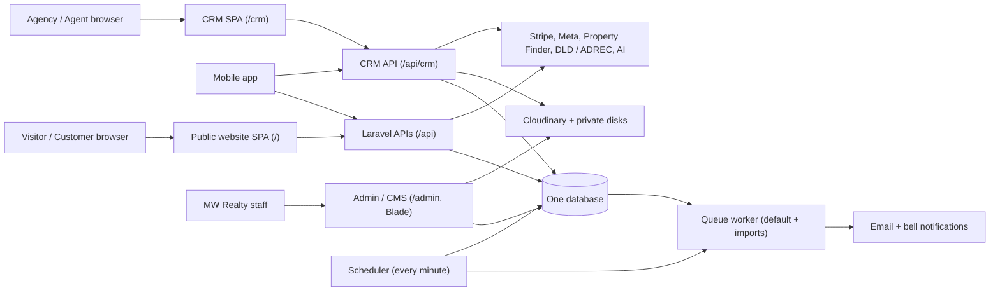

### 1.3 User types

| User type | Signs in at | Summary of rights |
|---|---|---|
| Visitor | No sign-in | Browses, searches, compares, sends enquiries and forms, uses the AI chat. Tracked anonymously by a browser cookie until identified. |
| Customer (shown as "User") | /login, tab User, or Continue with Google | Wishlist, saved searches, My Enquiries, account settings at /profile. No CRM access. |
| Agency | /login, tab Agent / Agency | Owns plan, credits, listings, leads and a team of agents. Can make 2FA compulsory for its agents. |
| Agent (independent) | /login, tab Agent / Agency | Own plan, credits, listings and leads; works like a one-person agency. |
| Agent (agency member) | /login, tab Agent / Agency | Uses the agency's plan and credits; sees own data plus agency leads and listings assigned to them. No Credits or Advertisements menu. |
| CMS staff | /admin | Admin users with a role; each menu needs a permission. |
| Super Admin | /admin, then the CRM button in the top bar | Full Admin. In the CRM: global view of every account plus Super Admin-only modules (Website Leads, Listing Permits, Listing Review, Marketing Properties, Property Options, ad review, Property Finder review). |

Old links /agent-login, /agency-login and /portal/login open /login; /agent-signup and /agency-signup open /signup.

## 2. Common functions

### 2.1 Authentication

Sign up (/signup) has three Account Type tabs: User, Agent and Agency.

- Partner sign-up requires name, email (not already used), phone and password (minimum 8 characters, confirmed). The Agency tab also asks for the agency name. An agent may pick an existing agency, which sends a join request; the agent stays independent until it is accepted and approved.
- Every new partner account starts with status pending, KYC status draft and the default Free plan.
- Every sign-up (customer and partner) confirms the email with a one-time code valid for 10 minutes. A wrong or old code shows "Invalid or expired code."; Resend sends a new one. A test environment may use a fixed test code instead (To be confirmed with the client).
- After a partner's code is accepted, the account is sent to /crm/security/two-factor to set up 2FA or choose Skip for now (not allowed when the agency enforces 2FA).

Log in (/login) has two tabs: User and Agent / Agency.

- Customers sign in with email and password, with an emailed code, or with Continue with Google. Google sign-in is available to customers only.
- Partners sign in with email and password. With 2FA on, a new browser first gets an emailed 6-digit code ("Verify it's you", 10 minutes), then the authenticator code (or a recovery code). A known browser skips the email step. The whole attempt expires after 15 minutes; 5 wrong codes in one attempt return the user to email and password.
- Admin staff sign in at /admin (CMS login).
- Disabling an account in Admin, or changing its password, signs its other CRM sessions out on their next request.

Password reset (/forgot-password) has the same two tabs. Step 1 checks the email (the account must exist, be enabled and have a verified email); step 2 sets a new password (minimum 8 characters, confirmed) within 15 minutes. Errors: "No agent or agency account found with this email.", "This email is not verified yet - please complete sign-up first.", "This reset session has expired - please start again."

> In the current code the reset step does not send a code or link to the mailbox before the new password is accepted (the customer API also has a reset-link endpoint). Whether this is the intended final behaviour is To be confirmed with the client.

An agent account created by an agency receives a signed set-password link by email when the Super Admin approves the membership.

### 2.2 Roles and access control

- Admin: role and permission per menu and action (User Management > Admins, Roles, Permissions). A missing menu item can mean a missing permission.
- CRM data scope: an agency sees its own and its team's data; an agent sees their own data and what is assigned to them; the Super Admin sees everything. A record of another account must never open, even by typing its ID in the URL.
- CRM locks: until KYC approval most modules show a padlock "Unlocks after KYC approval" and the server refuses the URL ("Your account is pending Super Admin approval."). Plan-gated features show "Upgrade your plan to unlock this" and an "Unlock ..." card. Gated features in the code (Plan::GATED_FEATURES): Lead insights, Property insights, Listing settings (watermark), Facebook Lead Ads, Property Finder, Agent insights (team performance); Reports and Advertisements are plan-based as well.
- Available before KYC approval: Dashboard, My Profile, Security, Contact Us, Help Desk, notifications, plan payment history and invoices.

### 2.3 Notifications

- Bell notifications in the CRM and Admin; emails for most events. Emails are queued and sent by the worker within 1 to 2 minutes; sign-up and login codes are sent immediately.
- Some events are bell-only by design: Listing Review hold / reject / approve, property import finished / failed.
- The main events per recipient are listed in each module subsection (section 3).

### 2.4 Languages and right-to-left

- The website language dropdown lists the languages enabled in Admin > Languages. English and Arabic exist; Arabic switches the layout to right-to-left.
- Listing content, blogs and most Admin content are stored per language (translations). Static website texts are managed as translation files edited in Admin.
- The AI chat has its own chat language (10 languages, see 3.31).

### 2.5 Currency

- Prices are stored in AED. The header currency switcher converts with rates managed in Admin > Currencies; the browser remembers the choice.
- When the server switch for automatic rates is on, rates refresh hourly from a live AED-based feed (currencies:sync-rates).

### 2.6 File uploads

All uploads are validated by type and size on the server; key limits are listed in section 6.2. Listing photos are converted to JPEG and watermarked on upload (Listing Settings). KYC and sale proof documents are private.

### 2.7 Lists, search and pagination conventions

- Standard CRM and Admin lists show 20 rows per page with server-side search and filters. Exceptions: Properties / Commercial 16 per page, Tags 50 per page, import history 10 per page.
- Pickers over records (accounts, leads, listings) search on the server and load 20 at a time, with more on scroll.
- Filters and the current tab are kept in the address bar where the guides say so (for example Reports ?range=).

### 2.8 Time zone

- The application stores times in UTC (config app.timezone = UTC).
- Business times use UAE time (Asia/Dubai): ad bookings, the permit-expiry job (00:05) and the renewal reminder (09:00). Jobs without an explicit time zone (Facebook page check 08:00, visitor clean-up 03:30) run at the scheduler's default time zone; whether that is UTC or UAE time on the server is To be confirmed with the client.

### 2.9 Anti-abuse

Public forms and logins are rate-limited per IP address (section 6.1). reCAPTCHA can be enabled on public forms (To be confirmed with the client for the test environment).

## 3. Functional specification per area

Each subsection follows the same pattern: Purpose, Actors, Preconditions, Main flow, Alternate / error flows, Validation rules, Outputs / notifications, Reference.

### 3.1 Public website: search and browse

- **Purpose:** let visitors find listings and partners.
- **Actors:** Visitor, Customer.
- **Preconditions:** listings are shown only while switched on (Active) and allowed to be live (permit Verified, not sold, permit not expired, not held by Listing Review).
- **Main flow:**
  1. Visitor opens Home (/): banner search, New Projects by city, Premium, Luxury Projects, Realty Property (Marketing list), communities, popular places, testimonials, ad slider.
  2. Visitor searches /properties or /commercial with filters (purpose, location / title suggestions, type, price, bedrooms, bathrooms, area, features, amenities).
  3. Visitor switches between list and map view (/properties/map, /commercial/map), opens /premium-properties or /marketing-properties.
  4. Visitor opens agent and agency directories and profiles (/agents, /agencies, detail pages).
- **Alternate / error flows:** no results shows an empty state and the Custom Property Request form; a guest clicking the wishlist heart is sent to /login.
- **Validation rules:** search filters are defined per page in Admin > Filters; location suggestions are throttled (120 per minute).
- **Outputs / notifications:** page views, searches and listing-card impressions are recorded against the visitor cookie.
- **Reference:** overview 00 section 2; guide 26 for Compare.

### 3.2 Public website: property details and enquiries

- **Purpose:** show a listing and capture buyer interest as a lead.
- **Actors:** Visitor, Customer; listing owner and agent receive the lead.
- **Preconditions:** listing is live; the slug /property-details/{slug} exists.
- **Main flow:**
  1. Visitor views tabs Overview, Features & Amenities, Gallery, Floor Plans, plus permit details, nearby places, Similar Properties and, for priced listings, Mortgage & Investment, Rental Costs and Market Insights.
  2. Visitor sends Enquire About This Property, Request Viewing, or downloads the brochure or floor plan (contact details first).
  3. The system creates or merges a CRM lead for the listing's owner and routes it (workflow 4.1).
- **Alternate / error flows:** a listing with no owner sends the lead to the Super Admin's unassigned pool; a repeat enquiry (same email or phone in the same account) is merged; more than 20 submissions per hour per IP is refused.
- **Validation rules:** name required; email or phone required; phone 7 to 13 digits without country code; reCAPTCHA when enabled.
- **Outputs / notifications:** owner and assigned agent get a bell and an email; the visitor's tracked activity is linked to the lead.
- **Reference:** guides 02, 04, 26.

### 3.3 Public website: customer account

- **Purpose:** give buyers and tenants a personal area.
- **Actors:** Customer.
- **Preconditions:** verified customer account (email code) or Google sign-in.
- **Main flow:**
  1. Customer signs up on the User tab and confirms the email code.
  2. Customer uses /profile: Overview, Wishlist, Saved Searches, My Enquiries, Account Settings.
  3. Customer adds or removes wishlist hearts and saves searches.
- **Alternate / error flows:** Google sign-in creates or links the account; account deletion is available in settings (API DELETE /api/customer/account).
- **Validation rules:** password minimum 8; avatar image max 2 MB.
- **Outputs / notifications:** sign-up or sign-in identifies the visitor as a website lead (Came in via Customer Account) in the Super Admin's pool.
- **Reference:** overview 00; guide 04.

### 3.4 Public website: content, calculators and forms

- **Purpose:** content pages and lead-generating forms managed from Admin.
- **Actors:** Visitor; Admin staff manage content.
- **Preconditions:** content is published in Admin.
- **Main flow:**
  1. Visitor reads blogs, market insights, careers, about, legal pages, landing pages (/{slug}).
  2. Visitor uses the mortgage, eligibility, rent-vs-buy and refinance calculators (computed in the browser; texts and FAQs from Admin > Calculators).
  3. Visitor submits the contact form, a landing-page form, a careers application or the newsletter sign-up.
- **Alternate / error flows:** rate limit 20 submissions per hour per IP; unknown slugs return the 404 page and are logged in Admin (404 logs, redirects).
- **Validation rules:** careers attachment PDF, DOC or DOCX, max 5 MB.
- **Outputs / notifications:** contact and landing-page submissions are saved in Admin > Enquiries (and landing-page enquiries), create a website lead in the pool and email the site address; careers create candidates in Admin.
- **Reference:** overview 00 section 2.

### 3.5 CRM 01: Dashboard

- **Purpose:** read-only summary of the account's leads and listings.
- **Actors:** Super Admin (global view), Agency, Agent.
- **Preconditions:** signed in to the CRM; never locked.
- **Main flow:**
  1. User opens /crm or /crm/dashboard.
  2. The page shows six KPI cards (Total enquiries, Deals in progress, Deals won, Need follow-up, Listings, Premium), charts (Performance 12 weeks, Conversion, Buyer Insights, Deal Pipeline) and lists (Latest Enquiries, Most Desired / Latest Properties, Inventory).
  3. Each card links to the related list.
- **Alternate / error flows:** a partner sees a plan card; the Super Admin sees a top-partners card and "Global view".
- **Validation rules:** none (read-only). Deleted leads are not counted; listing counts include sold and rented listings.
- **Outputs / notifications:** none.
- **Reference:** guide 01.

### 3.6 CRM 02: Leads

- **Purpose:** the inbox for people who want to buy, sell or rent.
- **Actors:** Agency, Agent, Super Admin.
- **Preconditions:** KYC approved; no plan lock.
- **Main flow:**
  1. Leads arrive from website forms, Facebook Lead Ads, Excel or Facebook CSV import and Add Lead.
  2. The system checks duplicates in the owner account (email, case ignored; phone, last 9 digits; every email and phone the lead ever used) and merges repeats.
  3. The lead is assigned (property agent, round robin, or left unassigned at agency level).
  4. The team sets stage, tags and notes, schedules follow-ups (Call, WhatsApp, Email), reassigns, and closes the lead by moving it to a closed stage.
  5. Bulk actions: Assign Stage, Assign Tag, Export, Delete, Distribute unassigned; deleted leads go to Deleted Leads (restore or delete permanently).
- **Alternate / error flows:** a match in Deleted Leads is restored and updated; a lead added with Add Lead is never auto-assigned; import runs in the background, one per account, and fails after 15 minutes without progress.
- **Validation rules:** name required (max 255); either email or phone required; phone 7 to 13 digits; note max 5000; follow-up note and outcome max 2000; import file .xlsx, .xls, .csv, .tsv or .txt, max 10 MB; Stage and Source in an import must exist in Master.
- **Outputs / notifications:** new lead bell + email to owner and assigned agent; follow-up reminder bell + email 15 minutes before due (job every 5 minutes); import finished notification and status file (kept 30 days); every change is written to the lead timeline.
- **Reference:** guide 02.

### 3.7 CRM 03: Lead Insights

- **Purpose:** rank leads by their behaviour on the public website.
- **Actors:** Super Admin (all leads), Agency, Agent.
- **Preconditions:** KYC approved; plan includes Lead insights.
- **Main flow:**
  1. User opens /crm/lead-insights.
  2. The totals strip shows leads with website activity, property views, total time on site and active this week.
  3. User searches and sorts the table (property views, time on site, searches, AI chats, last active) and opens a lead's Insights tab.
- **Alternate / error flows:** plan without the feature shows "Unlock lead insights"; leads created by hand, imports or Facebook have no activity unless later linked.
- **Validation rules:** none (read-only); 20 rows per page.
- **Outputs / notifications:** none.
- **Reference:** guide 03.

### 3.8 CRM 04: Website Leads

- **Purpose:** manage identified website visitors and the unrouted Lead Pool.
- **Actors:** Super Admin only.
- **Preconditions:** opened from Admin with the CRM button.
- **Main flow:**
  1. A visitor identifies (AI chat details, contact / home / calculator form, landing page, customer account, property enquiry) and becomes a website lead; an existing website lead with the same customer account, email or phone is reused.
  2. The lead waits in the Lead Pool (tabs Lead Pool, Routed Leads, All Website Leads).
  3. Auto-routing: two visits to one account's listings (repeat views within 30 minutes count as one) route the lead to that account as a CRM lead.
  4. The Super Admin can Transfer one or many leads to an agency or agent.
- **Alternate / error flows:** a person already routed stays with that account; a property enquiry creates the CRM lead immediately.
- **Validation rules:** transfer target must be an approved account; 20 rows per page.
- **Outputs / notifications:** routed or transferred lead appears in the target's Leads with its activity; sidebar badge counts pool leads from the last 7 days.
- **Reference:** guide 04.

### 3.9 CRM 05: Master Data

- **Purpose:** maintain the Stage, Tag and Source lists for leads, and (Super Admin) Property Options for the listing form and website search.
- **Actors:** Super Admin, Agency, Agent; Property Options is Super Admin only.
- **Preconditions:** KYC approved.
- **Main flow:**
  1. User adds, edits, reorders (drag) or deletes stages, tags and sources.
  2. Items added by the Super Admin are shared ("MW Realty" badge, view only for partners); items added by a partner are private to that account.
  3. One stage is the default; stages can be flagged Closed.
  4. Super Admin edits Property Options (types, locations, amenities, nearby place types, icons).
- **Alternate / error flows:** shared items cannot be edited or deleted by partners; system sources are created automatically when a lead arrives through that channel.
- **Validation rules:** names unique per visible list ("A stage with this name already exists." / "The name has already been taken."); option icon SVG, PNG, JPG or WebP, max 1 MB.
- **Outputs / notifications:** linked-leads view per item.
- **Reference:** guide 05.

### 3.10 CRM 06: Integrations

- **Purpose:** connect Facebook Lead Ads and Property Finder; hub for the Excel / CSV listing import.
- **Actors:** Super Admin, Agency, Agent (agency agents can view and sync Property Finder but not change it).
- **Preconditions:** KYC approved; plan includes the integration; MW Realty's Facebook app or Property Finder access configured.
- **Main flow:**
  1. Facebook: Continue with Facebook, pick Pages, connect; optional import of existing leads (all, 90, 30 or 7 days). New form leads arrive by webhook as CRM leads in the Page's account.
  2. Property Finder: save API key and secret, Import all listings, then Sync new listings. Imported listings are created off the website and wait for Super Admin review.
  3. Super Admin approves an import (it enters the normal permit flow) or rejects it (deleted and never imported again).
- **Alternate / error flows:** a Page connected to another account cannot be picked; pending Page lists expire after 15 minutes; a daily check flags broken Pages and emails the owner; plan limits stop a Property Finder import when the plan is full.
- **Validation rules:** one Page = one account; sync throttled (10 per minute).
- **Outputs / notifications:** Facebook leads synced / assigned, reconnect email, Property Finder results.
- **Reference:** guide 06.

### 3.11 CRM 07: Properties

- **Purpose:** create and manage residential listings, including the advertising permit.
- **Actors:** Agency, Agent, Super Admin (all listings, plus MW Realty's own).
- **Preconditions:** KYC approved; a free plan slot or credits for an extra listing.
- **Main flow:**
  1. User opens Add Property and fills the tabbed form (Core details, Property Details, Agent & Agency, Location, Amenities, Easy Access, Attributes, Floor Plans, Images, Brochure, Nearby Places, Publishing).
  2. User enters the permit for the emirate and clicks Validate (RERA / ADREC) when the online check is connected.
  3. On save the system recalculates the permit status, screens the listing (Listing Review) and applies the watermark to new photos.
  4. The listing goes live only when Active and allowed to go live.
  5. From the list the user edits, switches on or off, reorders, makes Premium, marks sold / rented and views Listing Performance (plan with Property insights).
- **Alternate / error flows:** plan allowance used up offers credits or an upgrade; changing permit, price, purpose, type, bedrooms or size of a Verified listing sends it back for checking; the same agency listing the same unit twice is refused.
- **Validation rules:** title per language required (max 255), address and city required, latitude and longitude required, price required; permit number max 64, letters, digits, dash and slash, unique across all listings; permit QR image max 2 MB; photos max 4 MB each, up to 30 per request; brochure max 20 MB; floor plan max 10 MB; DTCM permit is rent only.
- **Outputs / notifications:** listing sent for approval, approved, taken down, permit expiring (7 days before) and expired notifications.
- **Reference:** guide 07.

### 3.12 CRM 08: Commercial

- **Purpose:** the same listing management for commercial stock, shown on /commercial.
- **Actors:** Agency, Agent, Super Admin.
- **Preconditions:** as Properties; the plan allowance is shared with Properties.
- **Main flow:**
  1. User adds a listing from the Commercial menu; it stays a Commercial listing whatever its Category.
  2. All other steps are as in 3.11.
- **Alternate / error flows:** opening a commercial listing under /crm/properties redirects to /crm/commercial and the other way round; taken-down and expired commercial listings are counted in the Properties badge.
- **Validation rules:** as Properties; bedrooms and bathrooms are not required for quality score when Category is Commercial; credit cost uses the commercial rate.
- **Outputs / notifications:** as Properties.
- **Reference:** guide 08.

### 3.13 CRM 09: Listing Permits

- **Purpose:** Super Admin's permit review for every listing.
- **Actors:** Super Admin only.
- **Preconditions:** listings with permit details saved.
- **Main flow:**
  1. Super Admin opens /crm/listing-permits; five status cards act as tabs (Verified, Awaiting approval / Not verified, Permit details needed, Permit expired, Taken down).
  2. Super Admin opens a listing, compares the ad with the permit (checklist, review history) and clicks Approve & publish.
  3. Super Admin may Take down any listing with a reason.
- **Alternate / error flows:** DTCM and None (DIFC / JAFZA) permits always wait for approval; when the environment requires approval for every listing, all listings wait (approval policy To be confirmed with the client); sold and rented listings are not listed.
- **Validation rules:** take-down reason required.
- **Outputs / notifications:** owner is notified of approval and take-down; a taken-down listing stays offline until its permit details change.
- **Reference:** guide 09.

### 3.14 CRM 10: Premium

- **Purpose:** feature listings (Premium badge, home section, /premium-properties).
- **Actors:** Agency, Agent, Super Admin.
- **Preconditions:** KYC approved; plan Premium quota or credits; listing active.
- **Main flow:**
  1. User clicks Add Premium (or Make premium on a card), picks one or more listings, chooses Pay with (plan or credits), start and end dates.
  2. A future start makes the booking Scheduled; it goes Live on the start date and ends after the end date.
  3. User can edit, stop (live) or cancel (scheduled).
- **Alternate / error flows:** quota "at a time" frees a slot when a booking ends; quota "per month" is not returned when stopped early but is returned when cancelled before start; credit bookings have fixed lengths and cannot change dates.
- **Validation rules:** at least one listing; start date not in the past; end on or after start; maximum days per plan; credit periods 7, 15 or 30 days; listing must be active and not already Premium.
- **Outputs / notifications:** job every 15 minutes starts and ends bookings; the website Premium section shows up to 12 listings.
- **Reference:** guide 10.

### 3.15 CRM 11: Advertisements

- **Purpose:** book banner ads on website pages; MW Realty runs its own ads and reviews client ads.
- **Actors:** Agency, independent Agent (not agency agents); Super Admin.
- **Preconditions:** KYC approved; plan includes advertising, or credits.
- **Main flow:**
  1. Client books an ad in four steps: banner, link (listing, profile or web address), page and time (day, start hour, length), payment (plan ad or credits); then Book & send for review.
  2. Super Admin approves or rejects (with reason) on the Client ads tab.
  3. Approved ads run in the page's ad slider during the booked hours; impressions and clicks are recorded.
  4. Client views the ad report (KPIs, hour-by-hour chart, by day).
- **Alternate / error flows:** cancel before start; take down while live; a booking still in review when its time ends is closed as not reviewed and refunded (job every 15 minutes); a full page slot is refused.
- **Validation rules:** times in Dubai time, whole hours, up to 60 days ahead; banner image required on create (max per config, guide states 8 MB), phone image max 4 MB; text over image max 30 / 60 / 120 characters; ad name max 120.
- **Outputs / notifications:** ad reviewed notification to the client; Super Admin badge for ads waiting for review; credits or plan allowance returned on reject, cancel or expiry.
- **Reference:** guide 11.

### 3.16 CRM 12: Sold Listings

- **Purpose:** record a closed deal and keep a register of sold and rented listings.
- **Actors:** Agency, Agent, Super Admin.
- **Preconditions:** KYC approved; menu shown only when the account can see a sold or rented listing.
- **Main flow:**
  1. User clicks Mark as sold / rented on a listing card, enters outcome, price, date, optional commission, buyer (existing lead or new buyer) and uploads two proof documents.
  2. The listing goes off the website, Premium is removed, and it moves to Sold Listings.
  3. The buyer's lead moves to the owner's won stage ("Closed Won" is created if none exists) and gets a timeline entry.
  4. Revert puts the listing back on the market.
- **Alternate / error flows:** Revert reactivates the listing only if it was active before and can still go live; the lead keeps its stage and gets a "reverted" entry.
- **Validation rules:** ownership document (title deed) and contract (Form F / MOU or Ejari) required, PDF, JPG or PNG, max 10 MB each.
- **Outputs / notifications:** Sales report counts the deal on the sale date; documents are private.
- **Reference:** guide 12.

### 3.17 CRM 13: Marketing Properties

- **Purpose:** curated list for the home "Realty Property" section and /marketing-properties.
- **Actors:** Super Admin only.
- **Preconditions:** none.
- **Main flow:**
  1. Super Admin ticks accounts, ticks their active listings and clicks Add selected; new items go to the top.
  2. Super Admin reorders (drag or arrows) and removes items.
  3. The first 12 show on the home page; all show on /marketing-properties in the same order.
- **Alternate / error flows:** listings already on the list are skipped; inactive listings stay on the CRM list but are hidden on the website.
- **Validation rules:** only active listings of ticked accounts; up to 500 per add; MW Realty's own listings are not offered.
- **Outputs / notifications:** website cache cleared on every change.
- **Reference:** guide 13.

### 3.18 CRM 14: Agents and My Agency

- **Purpose:** build an agency's team and manage memberships.
- **Actors:** Agency, Agent, Super Admin (approval in Admin > Clients > Agency Agents).
- **Preconditions:** agency KYC approved; plan has free agent slots.
- **Main flow:**
  1. Agency adds a new agent, invites an existing agent, or accepts a join request.
  2. The membership becomes pending and the Super Admin approves or rejects it.
  3. Approved agents receive listings and leads; the agency sets lead assignment (Automatic round robin or Manual, per kind of lead).
  4. Agency can suspend, reactivate or remove; the agent can accept or decline invitations, request to join and leave.
- **Alternate / error flows:** duplicate email or mobile on Add offers to send an invitation instead; an agent already in another agency cannot be invited.
- **Validation rules:** full name, email and phone required and unique; experience 0 to 80; documents JPG, JPEG, PNG or PDF max 4 MB each; invite by exact email, mobile or agent ID.
- **Outputs / notifications:** membership change notifications; new agent receives a set-password email on approval; badge for join requests and invitations.
- **Reference:** guide 14.

### 3.19 CRM 15: Nearby Places

- **Purpose:** landmarks shown near listings on the public property page.
- **Actors:** Super Admin, Agency, Agent.
- **Preconditions:** KYC approved.
- **Main flow:**
  1. User adds a place: type, name and address per active language, latitude, longitude, Active switch.
  2. User tags places on a listing in the property form (Nearby Places tab).
  3. The public page shows active tagged places on the map, grouped by type, with distance.
- **Alternate / error flows:** only the creator (or Super Admin) can edit, switch or delete a place; delete is blocked while the place is tagged on any listing.
- **Validation rules:** type from Property Options; valid coordinates; name per language.
- **Outputs / notifications:** switching a place off hides it on every tagged listing.
- **Reference:** guide 15.

### 3.20 CRM 16: Listing Settings (watermark)

- **Purpose:** brand listing photos with a logo or text watermark.
- **Actors:** Agency and independent Agent (own), agency Agent (read-only), Super Admin (default watermark and account list).
- **Preconditions:** KYC approved; plan includes Listing settings.
- **Main flow:**
  1. User switches the watermark on, picks Logo or Text, position (9 spots), opacity and size, and saves.
  2. New photos uploaded to a listing (and Property Finder or file imports) are stamped.
- **Alternate / error flows:** the owner's watermark is used if on, complete and in plan; otherwise the Super Admin default; otherwise none. Existing photos are not changed.
- **Validation rules:** logo PNG, JPG or WebP max 4 MB; size 5 to 80 percent; opacity 5 to 100 percent.
- **Outputs / notifications:** preview on screen.
- **Reference:** guide 16.

### 3.21 CRM 17: Reports

- **Purpose:** performance reports for leads, properties, sales and agents.
- **Actors:** Super Admin, Agency (4 tabs), Agent (3 tabs, no Agents).
- **Preconditions:** KYC approved; plan includes Reports.
- **Main flow:**
  1. User opens /crm/reports and a tab (Leads, Properties, Sales, Agents).
  2. User picks a range: 7, 30 (default), 90 days or 12 months (?range=7, 30, 90, 365).
  3. User exports the Sales deals CSV.
- **Alternate / error flows:** any other range value falls back to 30 days; /crm/reports/revenue opens Sales; Super Admin also sees MW Realty Plan Sales.
- **Validation rules:** none (read-only). Won vs lost: closed stages whose name contains lost, drop, cancel, reject, dead or junk count as lost; other closed stages count as won.
- **Outputs / notifications:** CSV download.
- **Reference:** guide 17.

### 3.22 CRM 18: Help Desk

- **Purpose:** in-app quick guides for each CRM screen.
- **Actors:** all CRM users; content edited by Admin staff (Admin > Help Desk, permission help-desk.*).
- **Preconditions:** none.
- **Main flow:**
  1. User opens Support > Help Desk to see every active guide A to Z, or clicks the "!" icon in the top bar for the current screen.
  2. The guide opens as a slide tour (intro, features, steps, tips).
- **Alternate / error flows:** the first guide opens by itself once; after it is seen, no guide opens automatically again (help_auto_open, /help/seen).
- **Validation rules:** none.
- **Outputs / notifications:** none.
- **Reference:** guide 18 (placeholder guide; the behaviour above is taken from the code).

> Guide 18 currently describes ticket handling, which belongs to Contact Us (guide 19). The Help Desk module itself is the quick-guide library described above.

### 3.23 CRM 19: Contact Us (support tickets)

- **Purpose:** ticket desk between a partner account and MW Realty support.
- **Actors:** Agency, Agent; support staff in Admin > Support Tickets.
- **Preconditions:** none (available before KYC approval).
- **Main flow:**
  1. User raises a ticket: issue type, priority, subject, message, optional attachment.
  2. Support replies in Admin; by default the status becomes Awaiting Your Reply.
  3. User replies (ticket returns to Open), marks it Solved, or reopens it.
  4. Support can close the ticket (final).
- **Alternate / error flows:** a reply to a closed ticket is refused ("This ticket is closed. Please raise a new ticket if you still need help.").
- **Validation rules:** issue type from 10 categories; priority Low, Normal, High, Urgent; attachment JPG, PNG or PDF max 4 MB; replies throttled (20 per minute).
- **Outputs / notifications:** new ticket messages notify the site address / support; replies notify the user; badge for tickets awaiting the user's reply.
- **Reference:** guide 19.

### 3.24 CRM 20: Credits

- **Purpose:** pay-as-you-go add-ons beyond the plan.
- **Actors:** Agency, independent Agent; Super Admin (all histories); Admin grants credits.
- **Preconditions:** KYC approved; credits switched on in Admin (existing credits can still be used when off).
- **Main flow:**
  1. User sees balance, next expiry, plan usage and history.
  2. User buys credits (Stripe card) or receives an Admin grant; each batch is valid for the days set in Admin (default 30).
  3. Credits are spent on an extra listing, Premium for 7, 15 or 30 days, or an ad beyond the plan allowance.
  4. The calculator shows the cost by category, offering, type and price.
- **Alternate / error flows:** the batch expiring first is spent first; cancelled or rejected bookings refund credits; expired credits are written off hourly; agency agents have no wallet and are told to ask the agency.
- **Validation rules:** quantity and VAT computed server-side; calculator throttled (60 per minute).
- **Outputs / notifications:** history rows (top-up, grant, spend, refund, expire), CSV export.
- **Reference:** guide 20.

### 3.25 CRM 21: My Profile (KYC)

- **Purpose:** partner details, public page information and KYC documents.
- **Actors:** Agency, Agent (own profile only).
- **Preconditions:** none; 2FA set-up (or skip) first when required.
- **Main flow:**
  1. User completes sections (public details, compliance / licences, about, identity, documents, SEO).
  2. User uploads documents: Emirates ID, passport, RERA broker card or certificate, trade licence.
  3. User clicks Submit for Approval; KYC becomes submitted.
  4. Super Admin approves, rejects with a reason, requests information or flags single documents (Admin > Clients).
- **Alternate / error flows:** a rejected document or editing a KYC section after submission sets KYC to changes requested and requires resubmission; changing the login email has its own verification step (guide 21).
- **Validation rules:** documents JPG, PNG or PDF max 4 MB each; required fields per account type shown as "x/y" per section.
- **Outputs / notifications:** Super Admin bell and site email on submission; partner email and bell on each decision; daily email when a passport, trade licence or TRN expiry date has passed.
- **Reference:** guide 21.

### 3.26 CRM 22: Security

- **Purpose:** two-factor authentication and recognised devices.
- **Actors:** Agency, Agent.
- **Preconditions:** none.
- **Main flow:**
  1. User installs an authenticator app, scans the QR code and enters the 6-digit code (Verify & Enable).
  2. User saves the 8 recovery codes shown once.
  3. Agency can make 2FA mandatory for all its agents.
  4. User can disable 2FA (with a code) and see recognised devices.
- **Alternate / error flows:** with 2FA enforced, every CRM page stays blocked until set up; codes cannot be reused; neighbouring 30-second codes are accepted.
- **Validation rules:** exactly 6 digits; throttled by the otp-verify limit (8 per minute, 30 per day per IP).
- **Outputs / notifications:** new-device email code at sign-in.
- **Reference:** guide 22.

### 3.27 CRM 23: Plans

- **Purpose:** choose, pay for and change a subscription plan.
- **Actors:** Agency, independent Agent (agency agents see the agency plan, nothing to buy).
- **Preconditions:** KYC approved for choosing or buying; payment history always available.
- **Main flow:**
  1. User compares plans (Monthly / Yearly), optionally applies a coupon.
  2. With Stripe on: first purchase on Checkout; later changes in the change-plan window (upgrade charged now pro rata, downgrade at next renewal, stop auto-renew).
  3. With Stripe off (or a plan Stripe cannot sell): the choice creates a plan upgrade request approved or rejected in Admin.
  4. Each paid renewal creates a payment and an invoice (HTML and PDF).
- **Alternate / error flows:** cancel turns off auto-renew and drops to Free at period end; failed payments are recorded as Failed.
- **Validation rules:** coupon max 40 characters, 20 checks per minute, messages for invalid, inactive, expired, plan-restricted, used-up or already-used coupons; cardholder name required, max 60.
- **Outputs / notifications:** invoice email, renewal reminder the day before (09:00 UAE), plan unlocks applied immediately.
- **Reference:** guide 23.

### 3.28 CRM 24: Listing Review

- **Purpose:** Super Admin queue of listings flagged automatically on save (same unit listed by another agency, or risk signals).
- **Actors:** Super Admin only.
- **Preconditions:** a listing was saved and the screening raised a case; photo matching needs the queue worker.
- **Main flow:**
  1. Every save screens the listing; nothing is blocked at submission.
  2. Duplicate case: the oldest listing stays live; newer copies are held off the website.
  3. Risk case: signals such as price far below or above similar listings, details that don't add up, advertiser authority not confirmed, ad differs from the permit record, resubmitted after rejection; some only flag, others hold.
  4. Super Admin approves (hold lifted) or rejects with a reason (listing switched off until the agency fixes and saves it).
- **Alternate / error flows:** an open risk case closes itself as "Fixed by the agency" when a save leaves no signal; a decided listing cannot be decided twice; approved pairs are not matched again.
- **Validation rules:** rejection reason required.
- **Outputs / notifications:** bell only (no email) to owner and assigned agent: Listing waiting for review, Listing rejected, Listing approved; sidebar badge of open cases.
- **Reference:** guide 24.

### 3.29 CRM 25: Property Import and Write with AI

- **Purpose:** bulk-import listings from Excel / CSV and draft listing copy with AI.
- **Actors:** Agency, Agent (Super Admin not offered the import menu).
- **Preconditions:** KYC approved; plan listing allowance left; AI provider configured for AI features.
- **Main flow:**
  1. User uploads a file, matches columns to MW Realty fields (Purpose, Property type, Price and Community are required), optionally ticks AI descriptions and Translate, and starts the import.
  2. The import runs on the imports queue; progress shows live.
  3. Each row becomes Added, Needs details, Duplicate or Skipped; every created listing is Inactive and goes through the normal permit flow.
  4. Write with AI in the listing form drafts or improves title, key features and description for the selected language; nothing is saved until Save / Update.
- **Alternate / error flows:** one import per account at a time; plan limit reached mid-file skips remaining rows; no progress for 15 minutes marks the import failed.
- **Validation rules:** file .xlsx, .xls, .csv, .tsv or .txt max 10 MB; up to 30 photo URLs per listing; permit number 3 to 64 characters; a permit used by another account skips the row; AI notes max 2,000 characters.
- **Outputs / notifications:** bell only: Listing import finished / failed; status file kept 30 days.
- **Reference:** guide 25.

### 3.29a CRM 26: Agent Insights

- **Purpose:** show an agency how well each agent handles the leads and listings assigned to them.
- **Actors:** Agency (own current agents), Super Admin (agents of every agency). Agents have no access.
- **Preconditions:** KYC approved; plan includes Agent insights (`agent_insights`; Business and Enterprise at release).
- **Main flow:**
  1. User opens /crm/agent-insights (Insights > Agent Insights).
  2. Cards show agents, leads received in the period, untouched leads, overdue follow-ups and live listings.
  3. The table lists each agent with Agent score, leads received, response rate (acted on within 24 hours), median response time, untouched leads, overdue follow-ups, live listings, average listing quality and closed; default sort Needs attention first; period 7 / 30 / 90 days.
  4. User opens an agent: score breakdown with tips, and the untouched leads, overdue follow-ups and listings needing work, each linked to the lead or listing.
- **Business rules:** only agency-owned leads and listings assigned to the agent count; acting on a lead = note, stage or status change, or follow-up after the lead reached the agent; leads under 24 hours with no action are not judged; Agent score = points of the parts that apply (response rate 25, response time 15, no untouched leads 10, follow-ups on time 15, listing quality 20, live listings 15) scaled to 100.
- **Alternate / error flows:** plan without the feature shows "Unlock agent insights"; another agency's agent ID returns not found; an Agent login is refused.
- **Validation rules:** days 7, 30 or 90 (else 30); sort attention or name; search max 100 characters; 20 agents per page, 10 per attention list.
- **Outputs / notifications:** none (read-only, calculated live).
- **Reference:** guide 26.

### 3.29b CRM 27: Property Insights

- **Purpose:** show how every listing performs on the website over a period, so weak or unseen listings stand out.
- **Actors:** Agent, Agency (own listings; an agency agent also the agency listings assigned to them), Super Admin (every listing).
- **Preconditions:** KYC approved; plan includes Property insights (`property_insights`).
- **Main flow:**
  1. User opens /crm/property-insights (Insights > Property Insights). The sidebar group Insights holds Property Insights, Agent Insights, Lead Insights and Reports.
  2. Cards show listings (and live), impressions, listing clicks, lead clicks, leads in the period and listings with no impressions; a chart shows impressions and clicks per day.
  3. The table lists each listing with agent, impressions, clicks, lead clicks, leads and quality score; default sort Most impressions; period 7 / 30 / 90 days; Residential / Commercial filter; search.
  4. User clicks a row: the Listing Performance panel opens (same as Properties).
- **Business rules:** only listings on the market (not sold / rented); figures are sums of the daily listing counters for the period; leads = leads created for the listing in the period; quality is the current score.
- **Alternate / error flows:** plan without the feature shows "Unlock property insights"; KYC not approved is refused.
- **Validation rules:** days 7, 30 or 90 (else 30); sort impressions, clicks, leads, no_views or newest (else impressions); segment residential, commercial or empty; search max 100 characters; 20 listings per page.
- **Outputs / notifications:** none (read-only).
- **Reference:** guide 27.

### 3.30 Website 26a: Compare and Property Insights

- **Purpose:** side-by-side comparison and market / investment figures on listing pages.
- **Actors:** Visitor.
- **Preconditions:** listings live and priced.
- **Main flow:**
  1. Visitor ticks Compare on 2 to 5 listings and opens /compare?slugs=...
  2. The page shows prices, buying or move-in costs per emirate, yields, specs, nearest places, amenities and an AI or rule-based summary.
  3. On the property page, Mortgage & Investment, Rental Costs and Market Insights tabs show calculators and area figures.
- **Alternate / error flows:** a 6th pick is refused; with no AI the rule-based Quick summary is shown; figures with fewer than 3 samples show "Not enough data yet".
- **Validation rules:** compare list stored in the browser (localStorage mw-compare); compare 60 per minute, AI summary 10 per minute and 100 per day.
- **Outputs / notifications:** insight views counted per listing per page load.
- **Reference:** guide 26.

### 3.31 Website 26b: AI chat (Noor)

- **Purpose:** answer visitor questions with real listing results and capture the visitor as a lead.
- **Actors:** Visitor; Super Admin sees the resulting website lead.
- **Preconditions:** AI provider configured (otherwise the chat shows a not-available line).
- **Main flow:**
  1. Visitor asks one question freely.
  2. To continue, the visitor fills "Want to keep chatting?" (name, email, phone).
  3. The visitor becomes a website lead (Came in via AI Chat) in the Lead Pool; the conversation is saved.
  4. The assistant answers in the chosen chat language (10 languages) and shows up to 6 residential result cards with a match percentage, taken from a real site search.
- **Alternate / error flows:** Not now closes the form and puts the message back in the input; the form appears again on the next send; rate limit exceeded shows the chat error line.
- **Validation rules:** name required (max 255); valid email and phone; reCAPTCHA when enabled; 8 messages per minute and 150 per day per IP.
- **Outputs / notifications:** chat history and "Looking for" chips on the lead's Insights; routing as in workflow 4.9.
- **Reference:** guide 26; overview 00.

### 3.32 Admin: Clients and KYC

- **Purpose:** manage agent and agency accounts.
- **Actors:** Super Admin and staff with the client permissions.
- **Preconditions:** partner account exists.
- **Main flow:**
  1. Staff open a client, review details and documents.
  2. Staff approve, reject (reason), request information on chosen sections, or set each document to pending, verified or rejected.
  3. Staff enable or disable the account, reset password or 2FA, assign a plan, set payment status.
  4. Staff handle Agency Agents memberships (approve, reject, suspend, reactivate, remove) and Plan Upgrade Requests.
- **Alternate / error flows:** approval is possible only after the partner has submitted; a rejected document sets KYC to changes requested.
- **Validation rules:** status one of pending, approved, rejected; document status one of pending, verified, rejected.
- **Outputs / notifications:** email and bell to the partner on every decision; badges for waiting items.
- **Reference:** overview 00 sections 3 and 5; guides 14, 21, 23.

### 3.33 Admin: Plans, Payments, Coupons, Credits

- **Purpose:** commercial configuration.
- **Actors:** Super Admin and permitted staff.
- **Preconditions:** none.
- **Main flow:**
  1. Define plans: price, monthly or yearly, listing limit, Premium quota (at a time or per month, max days), ads per month and max length, agent limit, reports and gated features.
  2. View every plan payment with invoices.
  3. Create coupons: percent or fixed, duration once, N months or forever, limits.
  4. Credits: switch on or off, price per credit, VAT, validity, cost table; grant credits; view and export the ledger.
- **Alternate / error flows:** a plan with a one-time cycle cannot be sold through Stripe and uses the request flow.
- **Validation rules:** To be confirmed with the client (Admin forms are not covered by the CRM guides).
- **Outputs / notifications:** changes apply to CRM checks immediately.
- **Reference:** overview 00 section 5; guides 20, 23.

### 3.34 Admin: Support Tickets and Help Desk content

- **Purpose:** answer CRM tickets and maintain the in-app guides.
- **Actors:** support staff.
- **Main flow:**
  1. Staff open a ticket, reply (status after reply defaults to Awaiting Client), change status or close it.
  2. Staff create and edit help guides per CRM topic.
- **Alternate / error flows:** a closed ticket accepts no replies.
- **Validation rules:** attachment JPG, PNG or PDF max 4 MB.
- **Outputs / notifications:** the user is notified of replies.
- **Reference:** guides 18, 19.

### 3.35 Admin: Website content, filters and locations

- **Purpose:** manage everything the public website displays.
- **Actors:** content staff with permissions per area.
- **Main flow:**
  1. Edit home sections and headings, banners, about, why choose us, builders, testimonials, FAQs.
  2. Publish blogs and categories, market insights (topics, regions), landing pages, careers (vacancies, candidates), calculators, contact page, legal pages.
  3. Configure search filters per listing page, communities, Find Properties, locations.
- **Alternate / error flows:** public pages are cached for up to 180 seconds, so a change may take up to 3 minutes to appear unless the cache is cleared by the save.
- **Validation rules:** generic Admin uploads: images max 8 MB, documents (JPG, PNG, PDF) max 4 MB, spreadsheets max 10 MB, videos max 50 MB (testimonial video max 10 MB); blog extra images max 1 MB; career banner max 2 MB.
- **Outputs / notifications:** none.
- **Reference:** overview 00 section 5.

### 3.36 Admin: Enquiries, newsletter, unassigned leads, settings and SEO

- **Purpose:** inbound data and site-wide settings.
- **Actors:** permitted staff; Super Admin.
- **Main flow:**
  1. Review contact-form enquiries, landing-page enquiries, newsletter sign-ups (and scheduled newsletter content, sent every 15 minutes when due), and property leads with no owner (hand to a partner).
  2. Manage languages and translations, currencies (rates, default), site information.
  3. Manage SEO metadata, sitemap, robots.txt, URL redirects and 404 logs.
  4. Manage staff: Admins, Roles, Permissions.
- **Alternate / error flows:** a missing menu item usually means a missing permission.
- **Validation rules:** redirects: old path unique, max 2048 characters; canonical URLs must be http or https.
- **Outputs / notifications:** new contact, landing-page, career and newsletter submissions email the site address.
- **Reference:** overview 00 section 5.

## 4. Key workflows

### 4.1 Lead lifecycle

A lead is created or merged on capture, assigned, worked through the account's stages and closed. Status (Active / Inactive) is separate from stage and does not hide the lead.

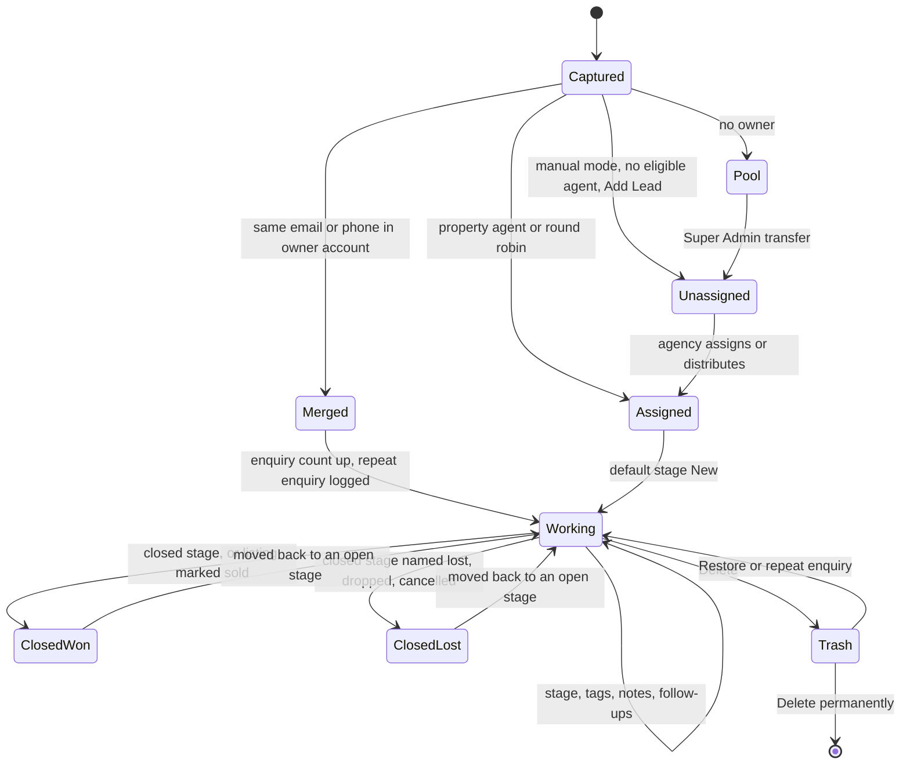

- Assignment labels stored on the lead: property_agent, round_robin, agency_unassigned, manual, reassigned.
- Moving into a closed stage stamps Closed On; moving back to an open stage clears it.
- An unassigned agency lead can also be worked at agency level before it is assigned.

### 4.2 Listing lifecycle

The permit (compliance) status is recalculated on every save. A listing is live only when it is switched on (Active), its compliance status is approved (Verified), it is not sold or rented, its permit has not expired and it is not held by Listing Review (Property::canGoLive).

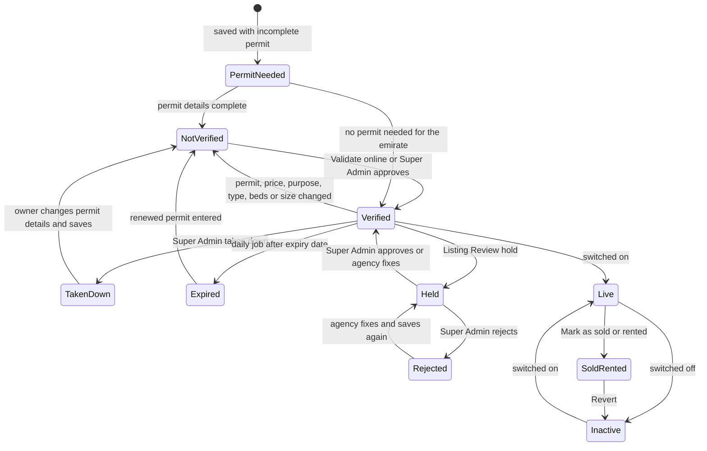

| Label in the diagram | Code value | Website |
|---|---|---|
| PermitNeeded | compliance_status = draft ("Permit details needed") | No |
| NotVerified | compliance_status = pending ("Not verified" / "Awaiting approval") | No |
| Verified | compliance_status = approved ("Verified") | Yes, when Active and not held |
| TakenDown | compliance_status = changes_requested ("Taken down") | No |
| Expired | compliance_status = expired ("Permit expired") | No |
| Held / Rejected | review hold on the listing, open Listing Review case | No |
| Live / Inactive | status = true / false (the website switch) | Live only |
| SoldRented | sale outcome sold / rented | No |

> A Verified listing edited without changing permit-relevant fields (description, photos) stays live. Revert makes the listing active again only if it was active before the sale and can still go live. Listings created by the Super Admin (MW Realty's own) are approved on save once their permit details are complete.

### 4.3 Partner sign-up and KYC approval

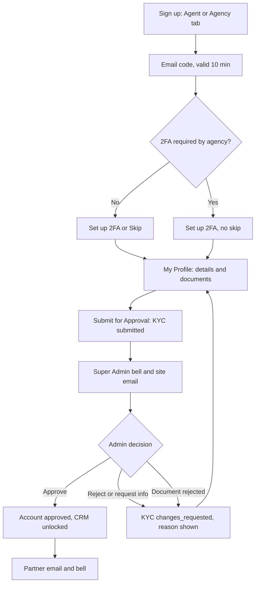

Agency membership (agent joining an agency):

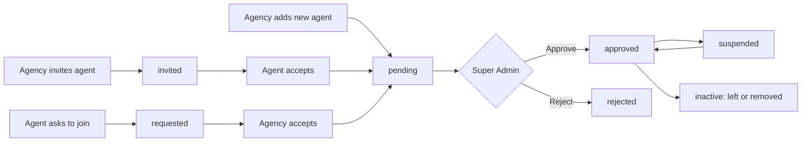

### 4.4 Plan purchase, renewal and credits

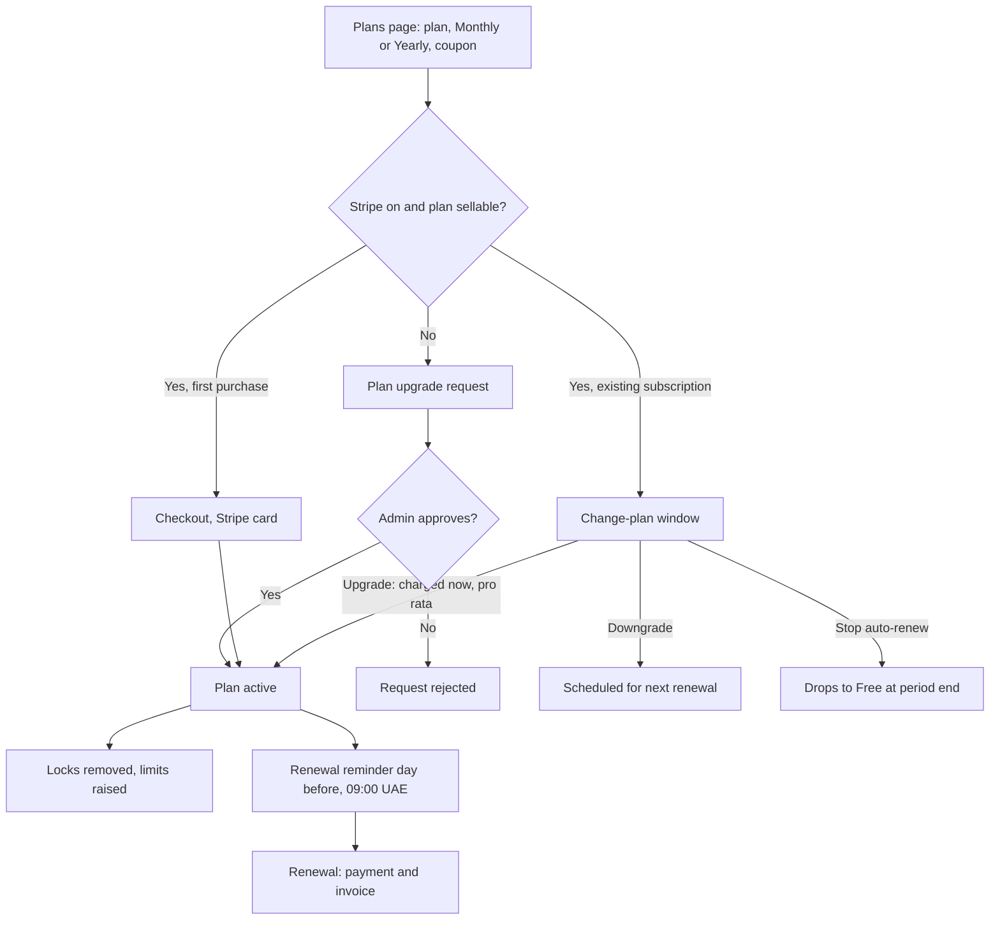

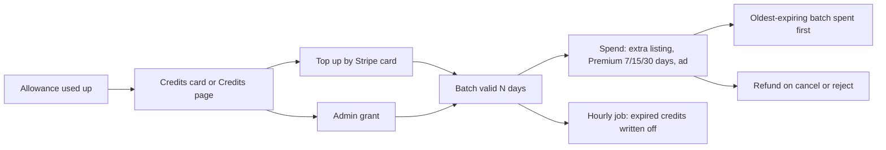

### 4.5 Premium featuring

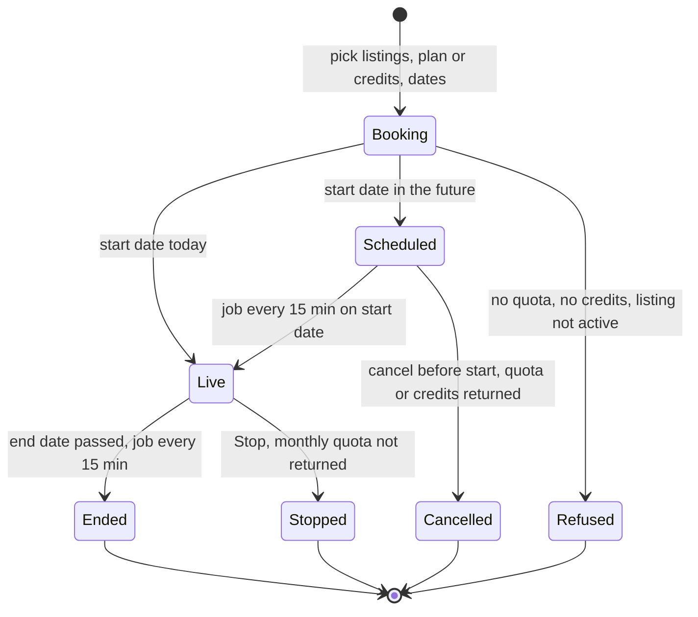

### 4.6 Advertisement booking and admin approval

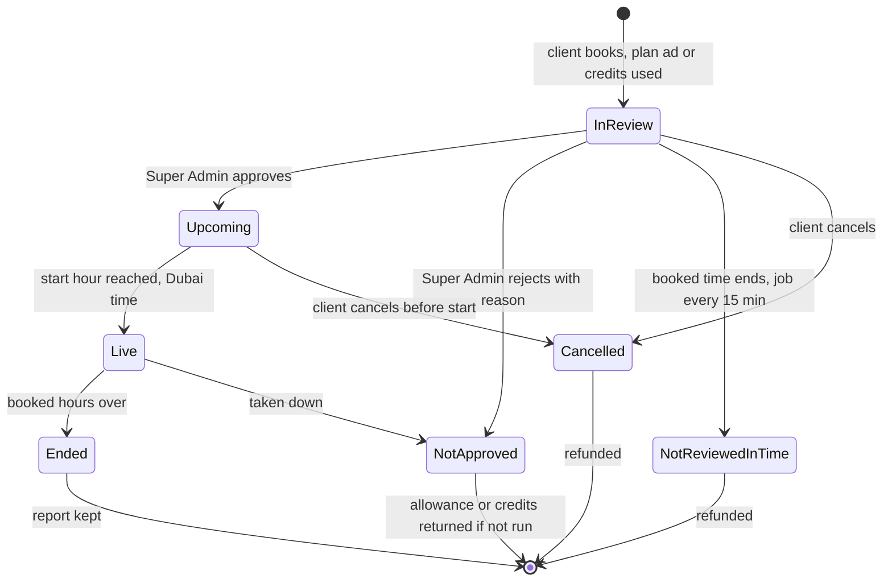

### 4.7 Help desk ticket lifecycle (Contact Us)

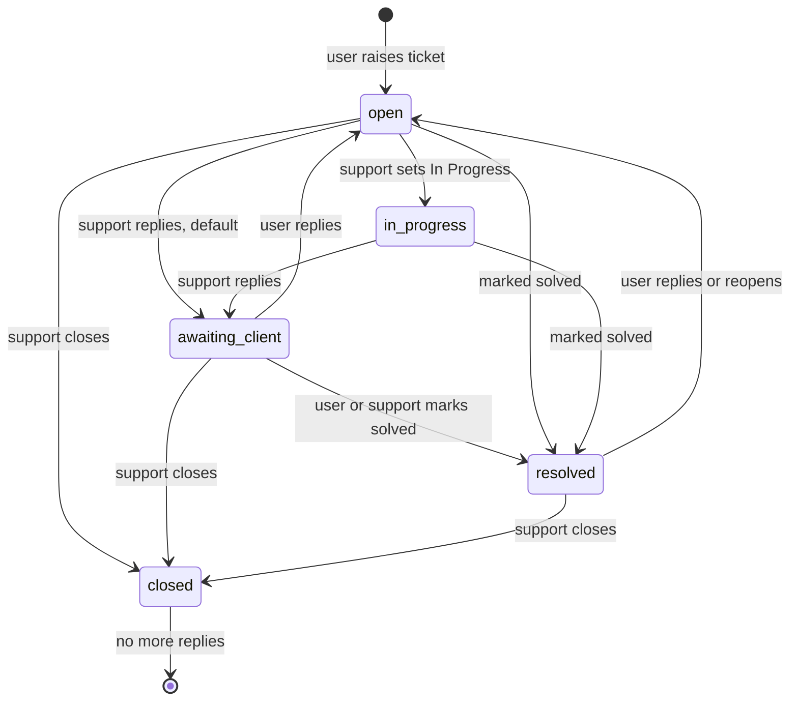

> A user reply on an In Progress ticket keeps it In Progress. Support can also pick any status in "Status after reply".

### 4.8 Property bulk import

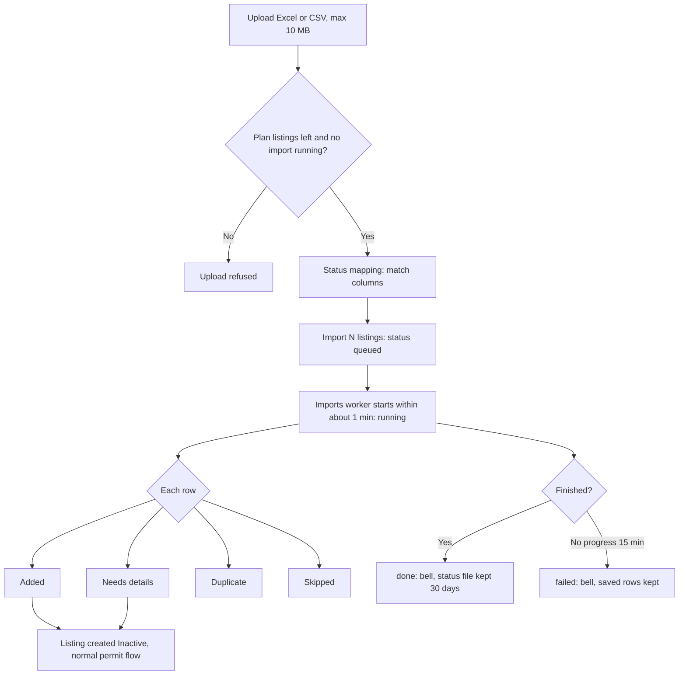

### 4.9 AI chat lead capture and routing

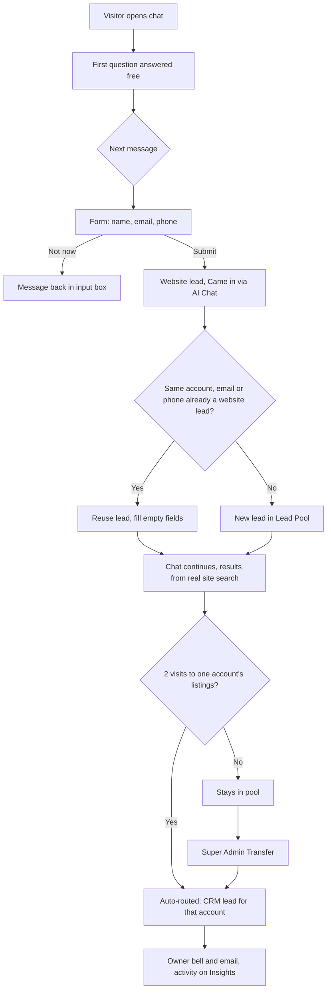

## 5. Status and enumeration reference

Values below are the stored values in the code; labels are what users see.

### 5.1 Partner account and KYC

| Field | Value | Meaning |
|---|---|---|
| portal_users.status | pending | New account, not approved; CRM modules locked. |
| | approved | Approved by the Super Admin; CRM unlocked. |
| | rejected | Application rejected with a reason ("Your application needs changes"). |
| portal_users.is_active | true / false | Admin enable / disable switch, independent of approval. Disabled accounts are signed out. |
| kyc_review_status | draft | Set at sign-up; profile not yet submitted ("Finish your KYC to unlock the CRM"). |
| | submitted | Partner clicked Submit for Approval ("KYC submitted - waiting for review"). |
| | changes_requested | Rejected, info requested, a document rejected, or a KYC section edited after submission; partner must resubmit. |
| | approved | KYC approved. |
| document_status (per document) | pending / verified / rejected | Admin's check of each uploaded document. |
| payment_status | paid / unpaid | Admin-visible payment flag on the account. |
| Account type | agency, agency_agent, individual_agent | Kind of partner account. |

### 5.2 Agency membership (agency_agents.status)

| Value | Meaning |
|---|---|
| invited | Agency invited an existing agent; waiting for the agent. |
| requested | Agent asked to join; waiting for the agency. |
| pending | Both sides agreed (or the agency created the agent); waiting for the Super Admin. |
| approved | Active member; eligible for listing and lead assignment. |
| suspended | Still a member, skipped for assignment. |
| inactive | Left or removed; history only. |
| rejected | Super Admin rejected. |
| declined | The invited agent or the requested agency said no. |
| cancelled | Withdrawn by whoever started it. |

Open statuses (use an agent slot): invited, requested, pending, approved, suspended.

### 5.3 Leads

| Field | Value | Meaning |
|---|---|---|
| leads.status | active / inactive | Manual flag ("Mark as Inactive / Active"); new leads are active; does not hide the lead. |
| Stage | Per-account list. Shared defaults: New (default), Hot Buyer, Active Buyer, Active Seller, Closed (closed), Negotiation, Dropped (closed), Connected | Pipeline step; is_closed marks a closing stage. A closed stage whose name contains lost, drop, dropped, cancel, cancelled, canceled, reject, rejected, dead or junk counts as lost; other closed stages count as won. Mark as sold uses the won stage ("Closed Won" is created if none exists). |
| Assignment reason | property_agent, round_robin, agency_unassigned, manual, reassigned | How the lead got its agent. |
| Follow-up status | scheduled, completed, cancelled | Follow-up types: call, whatsapp, email. |
| Lead import status | queued, running, done, failed | Background lead import. Row results Added, Updated, Skipped. |
| Website lead source (Came in via) | chatbot, contact-form, landing-page, property-enquiry, customer-account | First identifying action. |
| Website lead state | In pool / Routed | Pool = not yet routed to any account. |

### 5.4 Listings

| Field | Value | Meaning |
|---|---|---|
| compliance_status | draft | Permit details needed. |
| | pending | Not verified / Awaiting approval. |
| | approved | Verified; may be live. |
| | changes_requested | Taken down by the Super Admin. |
| | expired | Permit expired (daily job 00:05 UAE). |
| status | true / false | Active (switched on) / Inactive. |
| Sale outcome | sold / rented | Set by Mark as sold / rented. |
| Segment | residential / commercial | Properties or Commercial menu. |
| Premium | Live / Scheduled | Featured state; bookings that end or are stopped leave the Premium list. |
| Property Finder import | pending, approved, rejected | Super Admin review of imported listings. |
| Property file import | mapping, queued, running, done, failed | Excel / CSV import job. Row results Added, Needs details, Duplicate, Skipped. |

### 5.5 Listing Review

| Field | Value | Meaning |
|---|---|---|
| type | duplicate | Same unit, another agency (same location, purpose and unit number, or matching photos). |
| | risk | Risk signals on one listing. |
| status | open / resolved | Case state. |
| resolution | approved | Super Admin approved. |
| | rejected | At least one listing in the case was rejected. |
| | auto_cleared | "Fixed by the agency": a save left no signal. |
| Per-listing outcome | approved / rejected / empty | Decision per listing in the case; empty = waiting. |

### 5.6 Advertisements

Stored fields: review_status (pending, approved, rejected), status (on / off switch), cancelled_at, starts_at, ends_at. The displayed state is derived (Ad::state) in this order:

| Derived state | Rule | Client label |
|---|---|---|
| cancelled | cancelled_at set | Cancelled |
| rejected | review_status = rejected | Not approved |
| expired | end passed while review_status = pending | Not reviewed in time |
| ended | end passed after approval | Ended |
| pending | review_status = pending | In review |
| off | status switch off (MW Realty ads) | Off |
| scheduled | approved, start in the future | Approved - upcoming |
| live | approved, inside booked hours | Live |

Placements: home, commercial, agents, agent-details, agencies, agency-details, blogs, blog-details, properties-dubai, premium-properties, marketing-properties, property-details, market-insights, terms-and-conditions. Link types: url, property, profile.

### 5.7 Support tickets

| Value | User label | Admin label | Meaning |
|---|---|---|---|
| open | Open | Open | New, or the user replied / reopened; waiting for support. |
| in_progress | In Progress | In Progress | Support is working on it. |
| awaiting_client | Awaiting Your Reply | Awaiting Client | Support answered or asked for information. |
| resolved | Solved | Solved | Marked solved; can be reopened. |
| closed | Closed | Closed | Final; no replies. |

Categories: account, kyc, listings, leads, plans, payments, agency, technical, feature, other. Priorities: low, normal, high, urgent.

### 5.8 Plans, payments and credits

| Field | Value | Meaning |
|---|---|---|
| Plan interval | monthly / yearly | Billing period. |
| Plan payment status | paid / failed | Result of a charge. |
| Plan upgrade request | pending, approved, rejected | Request flow when Stripe is off or the plan cannot be sold online. |
| Coupon type | percent / fixed | Discount kind. |
| Credit transaction type | topup, grant, spend, refund, expire | Credit ledger rows. |

## 6. Non-functional notes visible in the code

### 6.1 Rate limits (per IP unless stated)

| Limiter | Limit | Used on |
|---|---|---|
| admin-login | 5 per minute per email and IP, and 30 per minute per IP | Admin, partner and customer login, Google sign-in (API) |
| portal-registration | 10 per hour | Partner and customer sign-up |
| otp-verify | 8 per minute and 30 per day | Email codes, resend, 2FA codes, reset email check |
| lead-capture | 20 per hour | Property enquiry, viewing, brochure, floor plan, custom and profile requests, chat details form |
| form-submit | 20 per hour | Contact, newsletter, careers, password reset |
| landing-page-enquiry | 20 per hour | Landing-page forms |
| ai-chatbot | 8 per minute and 150 per day | AI chat messages |
| ai-compare | 10 per minute and 100 per day | Compare AI summary |
| Fixed throttles (N per minute) | 10 to 600 | For example location suggestions and map 120, property insights and compare 60, permit Validate 30, coupon check 20, ticket reply 20, Facebook sync 10, Facebook webhook 600, page tracking 120 to 240 |

Exceeding a limit returns a "too many requests" error; this is expected behaviour.

### 6.2 File size and type limits

| Upload | Types | Max size |
|---|---|---|
| KYC documents, agent documents (CRM and Admin) | JPG, JPEG, PNG, PDF | 4 MB each |
| Listing photos | Images | 4 MB each, up to 30 per request |
| Listing main image | Image | 4 MB |
| Permit QR code | Image | 2 MB |
| Brochure | Allowed brochure extensions | 20 MB |
| Floor plan file | File | 10 MB |
| Sale proof documents | PDF, JPG, JPEG, PNG | 10 MB each |
| Lead import and property import file | xlsx, xls, csv, tsv, txt | 10 MB |
| Support ticket attachment | JPG, PNG, PDF | 4 MB |
| Ad banner and phone image | Image | From cms-kit image configuration (code fallback 4 MB; guide 11 states 8 MB banner, 4 MB phone) |
| Watermark logo | PNG, JPG, WebP | 4 MB |
| Property option icon | SVG, PNG, JPG, JPEG, WebP | 1 MB |
| Customer avatar | Image | 2 MB |
| Career application | PDF, DOC, DOCX | 5 MB |
| Admin generic uploads | Image / document / spreadsheet / video | 8 MB / 4 MB / 10 MB / 50 MB |

### 6.3 Queue and background processing

- Queue driver: database. The scheduler starts a worker every minute for the default queue (3 tries, stops when empty) and a separate worker for the imports queue (1 try, timeout 3600 seconds).
- Queued work: emails and notifications, Listing Review photo fingerprinting, lead imports, property imports, Property Finder imports, Facebook lead imports.
- Effects for testers: emails can take 1 to 2 minutes; imports can show "Starting import..." for up to about a minute; without a running scheduler and worker these do not happen.

### 6.4 Caching

| Data | Duration |
|---|---|
| Public page data (home, properties, commercial, map, property detail, agents and agencies, blogs, market insights, careers, legal, contact, footer, filters) | 180 seconds |
| Calculator pages | 3600 seconds |
| Currencies list and last update | 600 seconds |
| Location suggestions | 60 seconds |
| Property insights (per listing, refreshed when the listing is edited) | 3600 seconds |
| Compare AI summary (same listings, currency and language) | 1 hour |
| Chatbot lookup lists, Listing Review location labels | 3600 seconds |
| Admin dashboard summary | 30 seconds |
| Property Finder access token / location lookups | 20 minutes / 1 day |
| Password reset session | 15 minutes |

Some saves clear the related cache straight away (for example Marketing Properties); otherwise a change can take up to 3 minutes to show on the website.

### 6.5 Scheduled jobs (listed only; detailed in a separate document)

| Command | Frequency |
|---|---|
| queue:work (default) and queue:work imports | Every minute |
| leads:send-follow-up-reminders | Every 5 minutes |
| properties:expire-featured (Premium start and end) | Every 15 minutes |
| ads:settle (unreviewed ads closed and refunded) | Every 15 minutes |
| Newsletter campaign content due | Every 15 minutes |
| credits:expire | Hourly |
| currencies:sync-rates (only when auto sync is on) | Hourly |
| properties:expire-permits | Daily 00:05 UAE time |
| visitors:prune (anonymous activity older than 30 days) | Daily 03:30 |
| facebook:check-page-tokens | Daily 08:00 |
| portal:remind-subscription-renewals | Daily 09:00 UAE time |
| portal:notify-expiring-documents | Daily |
| landing-pages:cleanup-temp-images | Daily |

### 6.6 Other

- Data integrity: CRM write requests are all-or-nothing (database and uploaded files) and audit-logged.
- Security: sessions of a disabled account or after a password change are invalidated; KYC and sale documents are private; Listing Review never blocks a save (screening errors are logged).
- Browsers: current Chrome plus one of Firefox, Safari or Edge; desktop 1366 px and above and mobile width 375 to 414 px; Arabic right-to-left on the main pages.
- Open points To be confirmed with the client: email codes real or fixed on the test site; whether every listing needs Super Admin approval; DLD / ADREC online check connected; Stripe test mode; reCAPTCHA enabled; AI provider configured; server time zone for jobs without an explicit time zone; intended password-reset verification.
